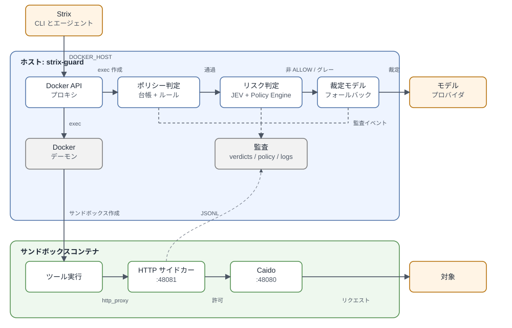
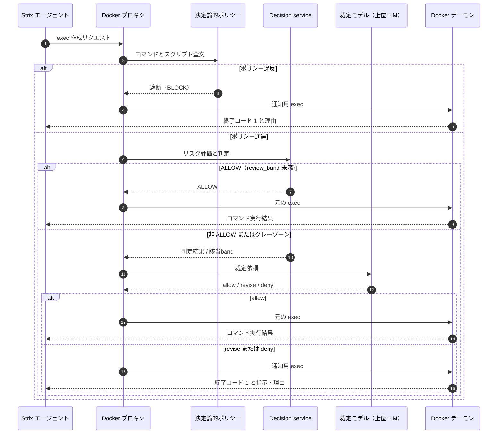
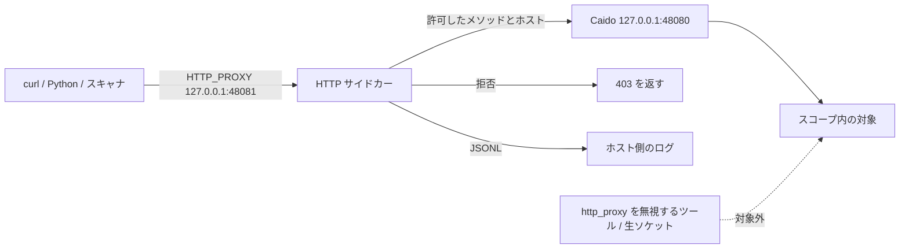
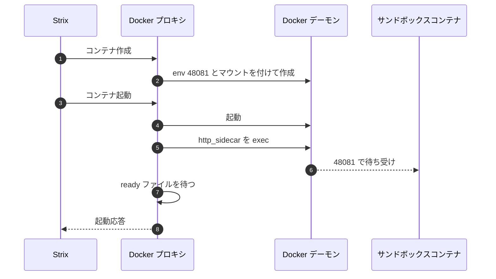

# strix-guard

[English](README.md) | **日本語**

[Strix](https://strix.ai) は、実際の攻撃オペレーションでも利用される自律型のペネトレーションテストエージェントです。strix-guard は、Strix 本体のコードやプロンプトに一切変更を加えることなく、エージェントが発行するシェルコマンドや HTTP リクエストに対して安全ポリシーを強制するガードレイヤーです。すべての `exec_command` コールをサンドボックス到達前にインターセプトして検査し、判断が曖昧なケースは上位の裁定モデル（フロンティアLLM）へ委譲します。さらにサンドボックス内部から HTTP メソッドやリクエスト頻度を制限することも可能です。Strix 本体、プロンプト、サンドボックスイメージはいずれも無改変のまま動作します。

> 本ツールは許可を得た正当なセキュリティテストにのみ使用してください。テスト対象のスコープ定義および実施権限の管理は、すべて利用者の責任となります。

## 目次

- [課題](#課題)
  - [過去の実行データ](#過去の実行データ)
- [解決策](#解決策)
  - [アーキテクチャ](#アーキテクチャ)
- [実際にどう制御するのか](#実際にどう制御するのか)
  - [exec ゲート](#1-exec-ゲート)
  - [決定論的ポリシー](#2-決定論的ポリシー)
  - [リスク評価と裁定モデル（上位LLM）](#3-リスク評価と裁定モデル上位llm)
  - [HTTP サイドカー](#4-http-サイドカー)
- [有効性の検証](#有効性の検証)
- [使い方](#使い方)
  - [リポジトリ構成](#リポジトリ構成)
  - [起動オプション（launcher）](#起動オプションlauncher)
  - [ポリシープリセット](#ポリシープリセット)
- [テスト](#テスト)
- [対象と制限](#対象と制限)
- [ドキュメント](#ドキュメント)

## 課題

近年、攻撃者は AI エージェントを活用して Web アプリケーションの脆弱性を自動探索するようになっています。最新鋭のモデルとツールをターゲットに向け、破壊的なアプローチも含めて自由に試行できます。攻撃者にとっては、試行が失敗したり対象システムが破損したりしても痛手にはならず、探索コストは極めて低いと言えます。

Strix 自体の悪用事例もすでに報告されています。Gambit Security は、オンライン小売業者に対して自律型 AI エージェントが用いられた事例を公開しています: [Autonomous AI agents on online retailers](https://gambit.security/blog-posts/autonomous-ai-agents-online-retailers-25-a-company)。

防御側にとっても、攻撃者と同じ視点を持つことが不可欠です。同じツールとモデルを使い、外部の攻撃者に見つかり得る脆弱性を事前に洗い出し、リスクに応じて改修したうえでリリースするサイクルが求められます。また、LLM が進化すれば過去に検出できなかった脆弱性が新たに顕在化する可能性があるため、テストは一度きりで終わらせず、リリースやモデル更新のたびに継続的に実施する必要があります。

しかし、ここには防御側特有の大きな非対称性が存在します。攻撃者はテーブル削除やファイル上書き、アカウントのロックといった破壊的操作を平然と行い、その結果を侵入成功の証拠にできます。一方、防御側は本番や本番同等の環境でエージェントを無制限に実行させるわけにはいきません。テストは非破壊であることが絶対条件です。読み取り操作を中心に据え、書き込みは検証用データやテストアカウントのみに限定し、リクエスト数にも上限を設けたうえで、変更した状態は元に戻さなければなりません。さらに、エージェントがこれらの制約を厳格に守って動作したことを客観的に証明する必要があります。

この安全性をプロンプトの指示だけで担保することは不可能です。次に実行するコマンドを決定するのはエージェント自身であり、モデルが破壊的な実行パスを選択したり、スクリプト内に隠蔽された更新系リクエストを見落としたりするリスクが常に存在するためです。また、危険なコマンドを遮断した際には、エージェントが別のアプローチへと自律的に切り替えられるよう、具体的な理由をフィードバックする必要があります。テスト完了後には、エージェントが何を試み、何が遮断され、どのリクエストが対象に到達したかを証明する監査証跡も欠かせません。

非対称性の具体例:

- **データ破壊**: 攻撃者は `DROP TABLE` や管理者アカウントの削除で影響を証明できます。防御側も同等の検証が必要ですが、データを破壊したままにはできません。使い捨てレコードで検証して元に戻すか、読み取り専用の証拠採取にとどめる必要があります。
- **高負荷・DoS**: 攻撃者は10万回もの連続ログイン試行を送信できます。防御側もレート制限の有効性を確認したいものの、試行回数には上限を設け、実ユーザーのロックアウトやサービス障害を防ぐ必要があります。
- **不正ファイル設置**: 攻撃者はウェブシェルをアップロードして実証できます。防御側はアップロード機能の処理を検証しつつも、危険なペイロードを実行させず、サーバーに不正ファイルを残さない制御が求められます。
- **スコープ逸脱**: 攻撃者はエージェントを第三者のホストへ向けることができます。防御側は宣言したテストスコープの外へ一切通信を出さず、かつ逸脱がなかったことを証明する必要があります。
- **モデル進化への追従**: 攻撃者は新しいモデルが登場すれば即座に実戦投入できます。防御側もモデル更新のたびに同一検査を再実行し、同一ポリシー下での再現可能な記録を蓄積する必要があります。

### 過去の実行データ

この非対称性は仮定ではありません。過去の Strix ベンチマーク実行 136 回・39,830 件の exec を、台帳でスクリプト本文を解決したうえで JEV で再評価しました。これらはガードを介さずに実行されたため、以下に挙げるコマンドは実際に実行されています。

- **Web向けコマンド 2,090 件（5.25%）**が危険なしきい値を超えました。内訳は対象データ露出 1,471、対象への破壊的操作 323、高負荷 365、第三者への攻撃 9、スコープ逸脱 1 です（分類は重複します）。JEV の全危険判定は 2,740 件で、残り 650 件はサンドボックス内（428）、ambiguous（221）、外部（1）として除外しました（サンドボックス内の `rm -rf` を含む）。
- 1 実行あたり平均 **15.4 件**（中央値 13 件）。200 件以上の大規模実行では平均 **19.7 件**です。
- Web向け危険 2,090 件のうち **855 件**は、PTY のファイル転送ラッパーの中に隠れたトークン窃取や大量登録などのスクリプトを台帳が復元して初めて危険と判定できたものです。
- 136 回の実行では `deepseek-v4.1-flash`、`glm-5.3-flash`、`mimo-v2.6-pro`、`mimo-v2.6-flash`、`qwen3.8-*` など複数のモデルが使われており、**どのモデルでも Web向けの危険なコマンドが出ています**。これは特定モデルの不具合ではなく、エージェントの振る舞いです。

これらの Web向けコマンドの多くは、脆弱性を確認するための検証操作そのものです（特にデータ露出）。問題は検証そのものではなく、**最小化しない検証**です。他ユーザー1件の取得で足りるところを一括で取得する、テストアカウントではなく実在しうるアカウントを使う、必要以上の回数を送る、といった行為です。この件数は攻撃数ではなく、そのリスクを伴うコマンドの規模を示します。この「最小限を超えた部分」こそが、ガードが減らすべき対象です。だからこそ、モデルの外側にある exec ゲートと HTTP サイドカーで強制する必要があります。方法と内訳: [日本語レポート](docs/JEV_CORPUS_REPORT.md) / [英語レポート](docs/JEV_CORPUS_REPORT.en.md)。データ: [Web向けCSV](docs/jev_corpus_web_risk.csv)、[全危険CSV（scope付き）](docs/jev_corpus_dangerous.csv)、[実行別CSV](docs/jev_corpus_runs.csv)、[モデル別CSV](docs/jev_corpus_models.csv)。全 39,830 件の分類は `guard_runs/jev_corpus_classification.csv` に生成されます（未コミット）。

## 解決策

strix-guard は、この非対称性の中で防御側が安全にペネトレーションテストを実施するための制御層（セーフティゲート）です。Strix 本体を一切変更することなく、2つの制御点を挿入します。

1. **Docker API プロキシ**: ランチャーがローカルプロキシを立ち上げ、Strix プロセスの `DOCKER_HOST` をこのプロキシに向けます。コンテナの作成、起動、exec コールはすべてプロキシを経由します。プロキシは実行コマンドを解析してポリシーを照合し、安全なコマンドはそのまま転送し、ポリシー違反時は警告通知コマンドへと差し替えます。差し替えられた場合、元のコマンドは一切実行されません。
2. **コンテナ内 HTTP サイドカー**: 参照のみのプリセット（`reference_only` と `recon`。詳細は[ポリシープリセット](#ポリシープリセット)）では、サンドボックスコンテナ内に軽量プロキシを常駐させます。コンテナの `http_proxy` をこのサイドカーに向け、サイドカーから Strix 既存の Caido プロキシへ中継します。これにより、シェルコマンドの静的検査では検知できない、実行時に動的生成された HTTP メソッドであっても確実に捕捉・遮断できます。

### アーキテクチャ



上図は2つの信頼境界を示しています。ホスト側の判定パイプラインがコマンド単位のポリシー検査とモデル裁定を担当し、サンドボックス内のサイドカーが HTTP メソッドやアクセス先ホストの制限を担います。各コンポーネントと実装コードの対応は以下のとおりです。

| 層 | 動作環境 | 主な役割 | 実装ファイル |
|---|---|---|---|
| ランチャー | ホスト | ポリシー解決、対話セットアップ、環境変数注入、UI、監査管理 | `strix_guard/launcher.py` |
| Docker API プロキシ | ホスト | コンテナ作成・起動・exec コールのインターセプト、通知コマンドへの差し替え | `strix_guard/docker_proxy.py` |
| 台帳（Ledger） | ホスト | `apply_patch`、heredoc、`cp`、`mv` 等のファイル書き込み履歴からスクリプト全文を復元 | `strix_guard/ledger.py` |
| 決定論的ポリシー | ホスト | HTTP メソッド、アップロード、SQL 書き込み、外部通信、攻撃ツールの高速な静的検査 | `strix_guard/policy_guard.py`、`strix_guard/policy_config.py` |
| Decision service | ホスト | JEV によるリスク次元評価と Policy Engine による判定の統合 | `strix_guard/decision.py`、`strix_guard/policy.py` |
| 裁定モデル（Adjudicator） | ホスト | 非 ALLOW 判定およびグレーゾーンコマンドの再審査、フォールバック制御 | `strix_guard/adjudicator.py` |
| サイドカーマネージャ | ホスト | サイドカーの構成準備、環境変数・バインドマウントの注入、プロセス起動 | `strix_guard/sidecar_manager.py` |
| HTTP サイドカー | サンドボックス | HTTP メソッド、ホスト、リクエスト件数、レート、並列数の制限、JSONL ログ出力 | `strix_guard/http_sidecar.py` |
| 監査ストア | ホスト | 判定ログ、ポリシースナップショット、サイドカーアクセスログの永続化 | `strix_guard/audit.py` |

ガード本体はホスト上で稼働し、Docker ソケット経由で制御を行います。HTTP サイドカーはサンドボックスコンテナ内部で動作し、ポリシーファイルを読み取り専用でマウント、アクセスログはホスト側のディレクトリへ直接出力します。LLM の API コールは設定されたプロバイダへ直接送信され、Strix 本体には一切改変を加えません。

決定論的なハードポリシーの検証は、LLM を呼び出す前に完了させます。LLM は境界線上の曖昧な判断や、エージェントに対する具体的なコマンド修正指示の生成を担い、LLM 単独に実行可否の全判断を委ねることはしません。

## 実際にどう制御するのか

### 1. exec ゲート

Docker API プロキシは `POST /containers/{id}/exec` リクエストを捕捉し、コマンド実行前のゲート判定を行います。結果は以下の3通りです。

- **許可（Allow）**: exec リクエストをそのまま Docker デーモンへ転送します。HTTP サイドカーが有効な構成では、exec プロセスの環境変数（`http_proxy` 等）もサイドカー宛てに自動設定されます。
- **修正（Revise）**: エージェントにコマンドの安全な修正を促します。ガードはコマンドを修正指示の出力と終了コード 1 を返すスクリプトに差し替えます。
  ```sh
  sh -c "printf '%s\n' '<修正指示メッセージ>'; exit 1"
  ```
  このとき、元のコマンドは一度も実行されません。
- **拒否（Deny）**: 同様の差し替えにより、コマンドの実行を即座に遮断してその理由をエージェントに返します。



Strix の PTY ラッパーが存在する場合は、ラッパー構造を維持したまま通知メッセージを差し込みます。これにより、Strix が標準出力を取得できる環境であればエージェントは通知内容を直接読み取ることができます。なお、Strix が非 TTY の exec で出力を空として返す場合でも終了コード 1 は確実に伝わり、通知本文も監査ログに記録されます。

### 2. 決定論的ポリシー

`reference_only` や `recon` プリセットでは、コストのかかるモデル評価を呼ぶ前に、シェルコマンドおよび台帳から復元したスクリプト全文を決定論的に静的検査します。

主な遮断対象:

- **許可外 HTTP メソッド**: 許可リストにないメソッド（`curl -X`、`-d`、`-F`、`-T`、`wget --post-*`、Python の `requests` / `httpx`、Node.js の `axios` / `fetch(..., {method})`、`ffuf -X` 等の呼び出し）
- **ファイルアップロード**: マルチパート送信やファイル転送フラグ
- **SQL 更新・破壊クエリ**: `INSERT`、`UPDATE`、`DELETE FROM`、`DROP TABLE`、`TRUNCATE`、`ALTER TABLE` 等
- **無許可の外部通信**: `egress.allow_external` が false の場合の外部宛て通信
- **攻撃ツール**: `recon` プリセットにおける高負荷スキャナや攻撃エクスプロイトツール

なお、Strix 自身の内部プロキシ（`127.0.0.1:48080`）は `egress.infra_hosts` に登録されています。このホスト宛ての通信のみを行うコマンドはエージェントのインフラ操作とみなされ、テスト対象向けメソッド制限の対象外となります。

### 3. リスク評価と裁定モデル（上位LLM）

JEV は Typesafe の高速で非常に安価な判定モデルです。コマンドを固定のリスク次元で採点するため、strix-guard は全 exec に組み込んでも待ち時間と費用をほとんど増やさずに検査できます。高価な裁定モデルは非 ALLOW とグレーゾーンだけに温存できます。JEV の判定コストは 1 件あたり約 $0.00002〜$0.00005 で、毎回の検査がテストの体験を損ないません。詳細: [Introducing System One models and JEV](https://typesafe.ai/blog/introducing-system-one-models-and-jev)（リンク先ではこの種のモデルを System One と呼んでいます）。

JEV（判定エンジン）は、破壊性・サーバー負荷・データ露出・スコープ違反・第三者影響という5つのリスク次元と、判断材料の十分性をスコアリングします。これを受け、Policy Engine が設定されたしきい値に基づいて最終判定（ALLOW / REVISE / HOLD / BLOCK / NEED_INFO）を下します。プロンプトは宣言された対象ウェブアプリに限定しており、サンドボックス内の `rm -rf /workspace/...`、ローカルのスクリプト書き込み、Caido のリクエスト閲覧は対象リスクとして数えないよう指示しています。レポートの過去コーパスは旧来の広いプロンプトで採点した結果を、別途スコープフィルタで集計したものです。

推論能力の高い上位モデル（裁定モデル / Adjudicator）を呼び出すのは、以下の場合に限られます。

- **非 ALLOW 判定の裁定**: `REVISE`、`HOLD`、`NEED_INFO` と判定されたコマンドを裁定モデルへ渡し、テスト文脈を考慮した最終判断（allow / revise / deny / escalate）と修正指示を生成させます。
- **ハードブロックの通知**: 明確な危険操作は即座にエージェントへ遮断を通知します。`--adjudicator-review-blocks` を指定した場合は再審査結果が監査ログに記録されますが、ハードブロック判定が緩和されることはありません（ソフトブロックのみ、モデルの確信度が十分高い場合に判定が緩和されます）。
- **グレーゾーンの再審査**: ALLOW のしきい値内であっても、いずれかのリスク次元が `review_band` を超過したコマンドは、セーフティネットとして裁定モデルへ助言を求めます（既定値は `full` が 0.30、`reference_only` と `recon` が 0.25）。

裁定モデルの既定フォールバック順:

```text
openai/gpt-6-sol → google/gemini-3.8-flash → anthropic/claude-opus-4.6
```

フォールバック機構を設けているのは、AI プロバイダの利用規約・セーフティ機構（例: `cyber_policy`）によってセキュリティ検証コマンドのプロンプトが拒絶されるケースがあるためです。優先モデルが拒絶した場合は後続のフォールバックモデルが自動的に審査を引き継ぎます。すべてのモデルが失敗した場合は fail-closed（安全側遮断）方針に従ってコマンドを拒否します。なお、グレーゾーン再審査時のエラーについては、ポリシー判定上すでに ALLOW が確定しているためコマンド実行は許可し、エラー詳細を監査ログに記録します。

| 状況 | Policy Engine 判定 | 裁定モデル（上位LLM） | 実行可否 |
|---|---|---|---|
| 決定論的ポリシー違反 | `BLOCK`（`policy_rule`） | 呼び出さない | 実行しない |
| ハードブロック | `BLOCK` | 再審査は任意（緩和不可） | 実行しない |
| ソフトブロック | `BLOCK` | 再審査（確信度 0.8 以上で緩和可） | 裁定結果による |
| `REVISE` / `HOLD` / `NEED_INFO` | 非 ALLOW | 裁定を実行 | allow / revise / deny に従う |
| `ALLOW` かつ `review_band` 以上 | `ALLOW` | グレーゾーン再審査 | allow / revise / deny に従う |
| `ALLOW` かつ band 未満 | `ALLOW` | 呼び出さない | そのまま実行 |
| JEV の障害・評価失敗 | ヒューリスティック判定 | 上記と同様に処理 | 上記と同様に処理 |
| すべての裁定モデルが失敗 | 非 ALLOW | 裁定エラー | 実行しない（fail-closed） |
| グレーゾーン再審査が失敗 | `ALLOW` | 裁定エラー | 実行する（ログにエラー記録） |

### 4. HTTP サイドカー

シェルコマンド文字列の静的検査だけでは、難読化されたコードや実行時に動的生成される HTTP メソッドを検知できません。たとえば以下のようなケースです。

```sh
python3 -c "import requests; m='PO'+'ST'; requests.request(m, 'http://host.docker.internal:5000/login')"
```

こうした迂回を防ぐため、`reference_only` および `recon` プリセットでは、サンドボックス起動時にコンテナ内で軽量プロキシ `http_sidecar.py` を常駐させます。サイドカーの主な機能は以下のとおりです。

- `127.0.0.1:48081` でリクエストを待機
- コンテナ内の `http_proxy`、`https_proxy`、`ALL_PROXY` 環境変数を引き受けてトラフィックを受信
- Strix 既存の Caido プロキシ（`127.0.0.1:48080`）へ多段中継
- 許可リストにある安全なメソッド（GET/HEAD等）とホストのみを通過させ、無許可リクエストには即座に 403 を返却
- `max_requests`（件数上限）、`max_rps`（秒間レート）、`max_parallel`（同時並列数）の上限値を強制
- ホスト側ディレクトリへ直接マウントされた領域に、JSONL 形式で全アクセスログを記録

なお、`NO_PROXY` には `localhost`、`127.0.0.1`、`api.caido.io` を事前設定し、Strix 本体の内部通信やテレメトリがサイドカーでループ・誤遮断されないように分離しています。



※ HTTP サイドカーが制御できるのは、プロキシ環境変数に従う標準的な通信に限られます。環境変数を意図的に無視するツールや低レベルな生ソケット通信はサイドカーを迂回可能です。参照限定のテストを確実に担保するには、読み取り専用のアクセス資格情報を用いるか、ターゲット側のネットワーク設定で書き込みを遮断してください。



`reference_only` では、HTTPS の CONNECT トンネリングを既定で拒否します。暗号化された CONNECT トンネル内部の HTTP メソッドは外部から検査できないためです。この制約を許容しトンネルを許可する場合に限り、ポリシーで `"allow_connect": true` を指定してください。

### 5. 監査証跡と再現性

テスト実行ごとに、`guard_runs/run-<timestamp>/` ディレクトリ配下へ以下の監査ファイルが出力されます。

- `verdicts.jsonl` — 全コマンドの評価結果、アクション、裁定モデルの判断、グレーゾーン再審査、ブロック再審査、サイドカーイベント
- `policy.json` — 実行時に実際に適用された実効ポリシースナップショット
- `http-*.jsonl` — サンドボックス内 HTTP サイドカーのアクセスログ（実行完了時に自動コピー）

ランチャー起動時には、適用ポリシーの SHA-256 ハッシュ値が表示されます。同一のポリシー設定とテスト引数を用いることで、まったく同じ判定基準のもとでテストを完全に再現・検証できます。

### 6. 障害発生時のフェイルセーフ動作

- **JEV（判定エンジン）の障害時**: ルールベースのヒューリスティック評価へと自動的にフォールバックして判定を継続します。
- **裁定モデルのエラー・プロバイダ拒絶時**: 設定されたフォールバックモデル順に審査を委譲し、全モデルで失敗した場合は安全側に倒して exec を拒否します。
- **グレーゾーン再審査のエラー時**: ポリシー判定上すでに ALLOW が確定しているためコマンド実行は通し、監査ログにエラー詳細を記録します。
- **サイドカーの起動失敗時**: 監査ログにエラーを記録します。コンテナのプロキシ設定はサイドカーを向いているため、サイドカーが稼働しない間の対象宛リクエストはすべて失敗し、制御外での勝手な通信を防ぎます。
- **非 TTY exec 時の出力欠落**: Strix 本体の仕様により、非 TTY 実行時にコマンド出力が空として返される場合があります。コマンドの成否は終了コード（遮断時は 1）で判断し、通知メッセージの詳細は監査ログ側で確認してください。

## 有効性の検証

テスト対象は、意図的に脆弱性を含む銀行アプリケーション [vuln-bank](https://github.com/Commando-X/vuln-bank) をローカルで改変したものです。モデルが学習時に上流プロジェクトを見ている可能性があるため、実行に使用したコピーでは、元の外観（UI/ブランド）やベンチマークと分かる文字列を削除・変更しています。したがって、公開ベンチマークの外観に依存しない未知のインスタンスに対する挙動を評価しています。

`vuln-bank-modified` に対する初期の統制A/B実行です。plain Strixとガードの`auto`モード（`full`ポリシー、`benchmark`環境、`standard`スキャン）を比較し、`deepseek-v4.1-flash`と`mimo-v2.6-flash`を各モード5回ずつ実行しました。baselineは既存実験からインポートしています。下表は5回分のTP/FP/FNを合算し、RecallはユニークGTの検出率で計算した累計値です。このターゲット・設定に対する結果であり、一般的な有効性の主張ではありません。

| モデル | モード | Precision | Recall | F1 |
|---|---|---:|---:|---:|
| `deepseek-v4.1-flash` | baseline | 96.94% | 60.00% | 74.12% |
| `deepseek-v4.1-flash` | guard | 96.94% | 63.33% | 76.61% |
| `mimo-v2.6-flash` | baseline | 96.77% | 58.33% | 72.79% |
| `mimo-v2.6-flash` | guard | 91.67% | 60.00% | 72.53% |

**実行時間の増加は自然です。** 5 run合計で、ガードはdeepseekの5,955アクション、mimoの78,864アクションを評価しています。一部のコマンドをREVISEで保留するため、エージェントは書き直して再試行する必要があります。また、高負荷なスキャンや総当たりを意図的に上限で制限します。これは性能劣化ではなく、意図した変更です。これらの実行で実際にあった修正例:

| 元のコマンド（抜粋） | ガードによる修正 |
|---|---|
| `ffuf ... -t 30 -rate 80` | `-t 10 -rate 10`、wordlistを500件・総リクエスト500件に制限 |
| `dirsearch ...` | `-t 10`、HTTPリクエストを500件にハードキャップ |
| PINループ `range(1000)` | 最大480試行・500リクエスト、レート制限付き |
| `POST /admin/delete_account/...`、`POST /admin/create_admin` | 削除。エージェントが作成したテストアカウントと読み取り専用プローブのみ |
| `DROP TABLE users`、150MB `RANDOMBLOB` | 削除。非破壊のSQLi証拠のみ |
| `python3 /workspace/rawfuzz.py` | 先にスクリプト内容を提示。その後500リクエスト・並列10・10リクエスト/秒 |

| モデル | baseline 平均 | guard 平均 | 5 run合計 |
|---|---:|---:|---:|
| `deepseek-v4.1-flash` | 22分 | 31分 | 1時間51分 → 2時間39分 |
| `mimo-v2.6-flash` | 1時間25分 | 2時間30分 | 7時間08分 → 12時間30分 |

deepseekのguardはbaselineと同じPrecisionを維持しRecallが向上、mimoのguardはF1がわずかに変化しRecallが向上しています。実行時間の増加（deepseek 22→31分、mimo 1時間25分→2時間30分）は、上記の評価・REVISE・スキャン上限によるもので自然です。各モデルのguard run 1回は前回実験からの引き継ぎで、旧来の広いJEVプロンプトを使用しています。残りのrunはターゲット限定プロンプトです。一般的な有効性の結論には、より大規模でペアの揃った評価が必要です。

## 使い方

### 必要なもの

- Python 3.10 以上（新しい型ヒントを使っています）
- Strix が実行できること（`~/.strix/bin/strix` か、`PATH` 上の `strix`）
- Docker ソケット（`/var/run/docker.sock`）と Docker CLI
- tmux（ポップアップ承認を使う場合のみ必要。任意）

インストールするパッケージはありません。プロジェクトのルートで実行します。

```bash
cd strix_guard
python3 -m unittest discover -s tests
```

### リポジトリ構成

```text
strix_guard/
├── .gitignore
├── README.md / README.ja.md
├── DESIGN.md
├── strix_guard/          # ガード本体（モジュールとして実行。インストール不要）
│   ├── launcher.py       # メイン入口: プロキシ、ポリシー、Strix 起動
│   ├── docker_proxy.py   # Docker API のインターセプトと通知差し替え
│   ├── decision.py       # JEV リスク評価 + Policy Engine
│   ├── adjudicator.py    # 上位モデルの裁定とフォールバック
│   ├── policy*.py        # 決定論的ポリシー、ポリシーファイル読み込み
│   ├── ledger.py         # エージェントが書いたスクリプトの復元
│   ├── sidecar_manager.py / http_sidecar.py
│   ├── audit.py / ui.py / webui.py / approve.py / setup.py / i18n.py
│   └── replay.py         # replay 入口（python3 -m strix_guard.replay）
├── tools/                # 独立した検証・分析スクリプト
├── tests/                # unittest スイート
└── docs/                 # 要件、テスト報告、JEV レポート、CSV
```

メインの実行単位はパッケージのエントリポイントです。

```bash
python3 -m strix_guard.launcher --help
python3 -m strix_guard.replay --help
```

`tools/` のスクリプトはリポジトリルートから直接実行します。

| スクリプト | 役割 | 必要なもの |
|---|---|---|
| `tools/verify_gate.py` | アクセスログ付きターゲットで5項目のゲート検証（許可は到達、遮断・修正・スクリプト内容は未到達） | Docker |
| `tools/retest_target_setup.sh` | 検証用 Apache（`httpd:2.4-alpine`）を 8081 で起動し、アクセスログをファイルに出す | Docker |
| `tools/retest_driver2.py` | Apache ターゲットに対する30項目の直接ゲート検証（exec環境のプロキシ、サイドカー上限、CONNECT、スクリプト解決） | Docker、Apache ターゲット |
| `tools/retest_adj_webui.py` | 実APIでの裁定フォールバック確認と Web UI 承認のスモークテスト | OpenRouter キー |
| `tools/docker_state.py` | Docker のバージョン、コンテナ、イメージをソケット経由で読み取り表示 | Docker ソケット |
| `tools/scope_filter.py` | exec を target / external / local / ambiguous に分類する共通フィルタ | なし |
| `tools/corpus_parent_stats.py` | 過去の Strix 実行から exec コマンドとモデル帰属を抽出 | 過去の Strix 実行 |
| `tools/corpus_jev_parent.py` | 136実行コーパスの JEV 再分類と CSV/レポート生成 | 過去の Strix 実行、JEV キャッシュ |
| `tools/corpus_map.py` | ガード監査と Strix 実行をコンテナIDで対応付け | ガード監査、Strix 実行 |
| `tools/corpus_jev.py` | ガード適用済み参照コーパスの JEV レポート | ガード監査、Strix 実行 |

`tests/` は回帰テスト一式です（`python3 -m unittest discover -s tests`）。`docs/` には要件、テスト報告、JEV コーパスレポート、CSV があります。

### 起動オプション（launcher）

同じ一覧は `python3 -m strix_guard.launcher --help` でも確認できます。Strix 自身の引数は `--` の後ろに置き、そのまま渡されます（一覧は `strix --help`）。

| 分類 | オプション | 既定値 | 説明 |
|---|---|---|---|
| 実行 | `--runs-dir DIR` | `./strix_runs` | Strix の実行状態の保存先（台帳が参照します） |
| 実行 | `--audit-dir DIR` | `~/blackbox-testing/strix_guard/guard_runs` | `run-<timestamp>/` 監査フォルダの親ディレクトリ |
| 実行 | `--dry-run` | off | Strix を起動せず、Docker プロキシとポリシー判定だけを動かす |
| ポリシー | `--policy-preset NAME` | `full` | テスト方針: `full` / `reference_only` / `recon`（[ポリシープリセット](#ポリシープリセット)） |
| ポリシー | `--policy FILE` | なし | JSON ポリシーファイル。プリセットを上書き（最優先） |
| ポリシー | `--no-http-enforce` | off | exec のルールは維持し、コンテナ内 HTTP サイドカーは起動しない |
| ポリシー | `--environment NAME` | `benchmark` | PII 既定値としきい値倍率を決める環境プロファイル |
| ポリシー | `--pii-policy NAME` | `test_data_ok` | `test_data_ok` はテストアカウントのデータ露出リスクを抑制、`strict` は通常の PII 評価 |
| ポリシー | `--test-accounts LIST` | 空（`STRIX_GUARD_TEST_ACCOUNTS`） | エージェントが読み書きしてよいアカウント（カンマ区切り） |
| 裁定 | `--adjudicator MODE` | `off` | `off` は人間に確認、`advisory` は提案のみ、`hybrid` は確信度 0.7 以上で適用、`auto` は全裁定を適用 |
| 裁定 | `--adjudicator-model NAME` | `openai/gpt-6-sol` | 非 ALLOW とグレーゾーン再審査の主モデル |
| 裁定 | `--adjudicator-fallback-models LIST` | `google/gemini-3.8-flash,anthropic/claude-opus-4.6` | プロバイダ拒否や失敗時に順に試すモデル |
| 裁定 | `--adjudicator-max-calls N` | `200` | 1 実行あたりの裁定呼び出し上限 |
| 裁定 | `--adjudicator-max-cost USD` | `3.0` | 1 実行あたりの裁定コスト上限（USD） |
| 裁定 | `--adjudicator-review-blocks` | off | `BLOCK` にも再審査を記録（ハードブロックは緩和されません） |
| 裁定 | `--no-gray-review` | off | `review_band` 以上の `ALLOW` に対する助言審査を無効化 |
| 裁定 | `--no-jev` | off | JEV を呼ばず、決定論的/ヒューリスティック評価のみ使う |
| 承認 UI | `--ui MODE` | `auto` | `auto` は TTY なら tmux ポップアップ、それ以外は web/CLI、stdin が非 TTY なら非対話。`cli` / `tmux` / `web` / `noninteractive` も指定可 |
| 承認 UI | `--on-ask ACTION` | `deny` | 非対話時に人間へ確認が必要な場合の応答（`deny` / `allow`） |
| 承認 UI | `--approval-timeout SEC` | `180` | 承認待ちのタイムアウト秒（超過で拒否） |
| 承認 UI | `--auto-allow-revised` | off | 修正後の同系統コマンドを許可済み範囲内で自動許可 |
| 承認 UI | `--strict` | off | しきい値を下げて確認を出やすくする（デモ用） |
| セットアップ | `--setup` | off | 起動前に設定ウィザードを表示（回答が各フラグを上書き） |
| セットアップ | `--no-setup` | off | 設定ウィザードを表示しない |
| セットアップ | `--language LANG` | `en` | UI と要約プロンプトの言語（`en` / `ja`） |
| パススルー | `-- <strix 引数>` | — | `--` 以降は Strix へそのまま渡す |
| 内部用 | `--no-wrap` | off | TTY UI 用の tmux 再実行を行わない |

ポリシーの読み込み順: `--policy` → `STRIX_GUARD_POLICY` → `./guard_policy.json` → `~/.config/strix-guard/policy.json` → `--policy-preset`。

### ポリシープリセット

ガードはプリセットに関係なく、すべてのモードで危険なコマンドを遮断または修正します。exec ゲート、決定論的ルール、JEV、裁定モデル、監査は常に動作します。プリセットが決めるのは開始時の許可範囲だけなので、テストを進められる範囲で最も制限の強いものを選んでください。

| プリセット | 許可する HTTP メソッド | アップロード / SQL 書き込み / 外部通信 | コンテナ内 HTTP サイドカー | 使いどころ |
|---|---|---|---|---|
| `full`（既定） | `GET` `HEAD` `OPTIONS` `POST` `PUT` `PATCH` `DELETE` | 許可 | なし | 使い捨ての検証環境や、書き込みを許すステージング |
| `reference_only` | `GET` `HEAD` `OPTIONS` | 禁止 | あり | 本番同等データに対する参照のみの検証 |
| `recon` | `GET` `HEAD` `OPTIONS`（レート上限は低め、攻撃ツールなし） | 禁止 | あり | 稼働中システムの初回棚卸し |

プリセットは[ポリシーの読み込み順](#カスタムポリシー)の最後に位置します。`--policy` ファイル、`STRIX_GUARD_POLICY`、`./guard_policy.json`、ユーザ設定のいずれかがあれば、そちらが優先されます。グレーゾーン再審査の `review_band` 既定値は `full` が `0.30`、`reference_only` と `recon` が `0.25` です。

### 最短の起動: セットアップウィザード

```bash
python3 -m strix_guard.launcher --setup -- \
  --target http://host.docker.internal:5000
```

ウィザードは、環境、テスト方針、裁定モード、言語、PII 方針、モデル、タイムアウト、テストアカウントを対話形式で確認します。production の既定は `reference_only` です。

### 非対話の自動裁定

```bash
python3 -m strix_guard.launcher \
  --ui noninteractive --on-ask deny \
  --adjudicator auto --adjudicator-review-blocks \
  --pii-policy test_data_ok \
  -- --target http://host.docker.internal:5000 --non-interactive
```

Strix の既定（`deep`、エージェントごとのターン上限 500、予算上限なし）をそのまま使います。実行を区切りたいときは、`--` の後ろに Strix の引数を渡します。

```bash
python3 -m strix_guard.launcher \
  --ui noninteractive --adjudicator auto \
  -- --target http://host.docker.internal:5000 --non-interactive \
  --scan-mode standard --max-turns 30 --max-budget 2.0
```

### 参照のみのテスト

```bash
python3 -m strix_guard.launcher \
  --ui noninteractive --adjudicator auto --adjudicator-review-blocks \
  --policy-preset reference_only \
  -- --target http://host.docker.internal:5000 --non-interactive
```

`reference_only` は HTTP サイドカーを有効にします。`GET`、`HEAD`、`OPTIONS` だけを中継し、アップロードと SQL の書き込み、外部通信を止めます。`recon` も同様ですが、レート上限が低く、攻撃ツールを使いません。

exec のルールは残したまま、サイドカーだけを止める場合:

```bash
--policy-preset reference_only --no-http-enforce
```

### カスタムポリシー

```bash
python3 -m strix_guard.launcher \
  --policy ./guard_policy.json \
  --ui noninteractive --adjudicator auto \
  -- --target http://host.docker.internal:5000 --non-interactive
```

`guard_policy.json` の例:

```json
{
  "version": 1,
  "preset": "reference_only",
  "review_band": {
    "destructiveness": 0.30,
    "load": 0.30,
    "data_exposure": 0.30,
    "scope_violation": 0.30,
    "third_party": 0.30
  },
  "http": {
    "enforce": true,
    "allowed_methods": ["GET", "HEAD", "OPTIONS"],
    "max_requests": 500,
    "max_parallel": 10,
    "max_rps": 10,
    "allow_uploads": false,
    "allow_connect": false
  },
  "egress": {
    "allow_external": false,
    "allowed_hosts": ["host.docker.internal:5000"],
    "infra_hosts": ["127.0.0.1:48080", "localhost:48080"]
  },
  "data": {
    "allowed_test_accounts": ["alice", "bob"],
    "allow_other_accounts": false,
    "allow_writes": false,
    "restore_after_write": true
  }
}
```

ポリシーの読み込み順:

1. `--policy FILE`
2. `STRIX_GUARD_POLICY`
3. `./guard_policy.json`
4. `~/.config/strix-guard/policy.json`
5. 選択したプリセット

未定義のキーが含まれていると、起動時にエラーになります。解決後のポリシーは `guard_runs/<run>/policy.json` に保存します。

### グレーゾーン再審査

裁定モデルを有効にすると、グレーゾーン再審査も既定で有効になります。

```bash
# 既定: review_band 以上の ALLOW を再審査する
--policy-preset reference_only --adjudicator auto

# 再審査を止める
--policy-preset reference_only --adjudicator auto --no-gray-review
```

次元ごとの band はポリシーファイルで指定します。`0` にすると、その次元は再審査しません。

### フォールバックモデル

```bash
--adjudicator-model openai/gpt-6-sol \
--adjudicator-fallback-models google/gemini-3.8-flash,anthropic/claude-opus-4.6
```

### テストアカウントと PII

`--test-accounts` は、どのアカウントがテスト用かをガードに伝えます。一覧は JEV の state と裁定モデルの context に渡されるため、モデルは許可された読み書きを他ユーザーのデータと誤認しません。

```bash
# 検証ラボ: alice と bob だけをエージェントが使えるアカウントにする
python3 -m strix_guard.launcher \
  --environment benchmark --pii-policy test_data_ok \
  --test-accounts "alice,bob" \
  --adjudicator auto \
  -- --target http://host.docker.internal:5000 --non-interactive -m quick

# ステージング: 厳格な PII 評価と QA アカウント 1 件
python3 -m strix_guard.launcher \
  --environment staging --pii-policy strict \
  --test-accounts "qa-user@example.com" \
  --adjudicator hybrid \
  -- --target https://staging.example.com --non-interactive
```

アカウントはユーザー名・数値 ID・メールアドレスのいずれでも構いません。`STRIX_GUARD_TEST_ACCOUNTS` でも指定でき、`--test-accounts` がポリシーファイルより優先されます。一覧をポリシーと一緒に管理する場合:

```json
{
  "preset": "reference_only",
  "data": {
    "allowed_test_accounts": ["alice", "bob"],
    "allow_other_accounts": false,
    "allow_writes": false,
    "restore_after_write": true
  }
}
```

アカウント一覧だけではプリセットの許可範囲は広がりません。`data.allow_other_accounts` は一覧外のデータを許可するかを JEV と裁定モデルに伝え、`data.allow_writes` は SQL 書き込みを制御し、`data.restore_after_write` は変更後に状態を戻す前提を記録します。`test_data_ok` がデータ露出スコアを下げる（上限 0.4）のは `benchmark` プロファイルだけで、`staging` と `production` は通常 `strict` を使います。

### 承認 UI

```bash
# tmux ポップアップ（TTY での既定）
--ui tmux

# ブラウザの承認ページ
--ui web

# CLI の質問
--ui cli

# 人間を置かず、自動裁定か拒否にする
--ui noninteractive --on-ask deny
```

### dry-run、ゲート検証、リプレイ

```bash
# Strix を起動せず、Docker プロキシとポリシーだけを動かす
python3 -m strix_guard.launcher --dry-run --policy-preset reference_only

# 遮断・修正したコマンドが対象へ届いていないことをアクセスログで確かめる
python3 tools/verify_gate.py

# コマンドカタログを判定パイプラインに通す
python3 -m strix_guard.replay <exec_cmds.jsonl> --limit 20
```

### 環境プロファイル

`--environment` は実行プロファイル名で、JEV に渡されます。設定ウィザードも同じ項目を質問し、選んだプロファイルから裁定モード・承認タイムアウト・しきい値倍率・コスト上限を埋めます。ウィザードを使わない場合は、以下の例のように各フラグを明示してください。

| プロファイル | PII 方針 | 裁定モード | 承認タイムアウト | しきい値倍率 | コスト上限 | ウィザードのプリセット |
|---|---|---|---|---|---|---|
| `benchmark` | `test_data_ok` | `auto` | 180 秒 | ×1.0 | $3.0 | `full` |
| `staging` | `strict` | `hybrid` | 120 秒 | ×0.5 | $1.5 | `full` |
| `production` | `strict` | `hybrid` | 60 秒 | ×0.1 | $1.0 | `reference_only` |

```bash
# 検証ラボ: full プリセット、書き込み許可、テストアカウントはテストデータ扱い
python3 -m strix_guard.launcher \
  --environment benchmark --policy-preset full --pii-policy test_data_ok \
  --test-accounts "alice,bob" --adjudicator auto \
  -- --target http://host.docker.internal:5000 --non-interactive -m quick

# ステージング: 参照のみ、しきい値は厳しめ、hybrid 裁定
python3 -m strix_guard.launcher \
  --environment staging --policy-preset reference_only --pii-policy strict \
  --adjudicator hybrid --approval-timeout 120 --adjudicator-max-cost 1.5 \
  --test-accounts "qa-user@example.com" \
  -- --target https://staging.example.com --non-interactive

# 本番相当: 参照のみ、人間を置かず、確認が必要なら拒否
python3 -m strix_guard.launcher \
  --environment production --policy-preset reference_only --pii-policy strict \
  --ui noninteractive --on-ask deny \
  --adjudicator hybrid --approval-timeout 60 --adjudicator-max-cost 1.0 \
  --test-accounts "qa-user@example.com" \
  -- --target https://www.example.com --non-interactive
```

`--setup` を使うと、ウィザードが同じ項目（環境・ポリシー・モード・言語・PII・モデル・タイムアウト・アカウント）を質問し、回答を実行に反映します。本番の参照のみテストなら、回答は `production`、`reference_only`、`hybrid`、`ja`、`strict`、`openai/gpt-6-sol`、`60`、`qa-user@example.com` です。

### 監査ファイル

```text
guard_runs/run-20261101-145329/
  verdicts.jsonl       判定結果、アクション、グレーゾーン再審査、サイドカーイベント
  policy.json          実行時に適用された実効ポリシー
  http-2b6e....jsonl   HTTP サイドカーのアクセスログ
```

### トラブルシューティング（困ったとき）

- `policy error: unknown ...` — ポリシー JSON に未定義のキーが含まれています。不要なキーを削除するか、スペルを確認してください。
- `http sidecar setup failed` — Docker デーモンがキャッシュディレクトリを読み取れるか、バインドマウントが許可されているかを確認してください（サイドカーは `~/.cache/strix-guard-http-*` 配下に配置されます）。
- エージェントが「コマンド出力が得られない」と報告する — Strix の仕様上、非 TTY 環境の exec 実行時に標準出力が空になる場合があります。終了コード 1 および監査ログを確認してください。コマンド自体は正しく遮断されており、サンドボックス内で実行されていません。
- `reference_only` で HTTPS 通信が通らない — 暗号化された CONNECT トンネル内部の HTTP メソッドは外部から検査できません。この制限を許容できる場合のみ、ポリシーで `allow_connect` を `true` に設定してください。
- `--target-list` で指定した対象がサイドカーの許可リストに含まれない — ポリシーファイルの `egress.allowed_hosts` に対象ホストを追加してください。サイドカーは CLI で指定された単一の `--target` URL と本リストを参照します。
- AI プロバイダがセキュリティ内容を拒絶する — 設定されたフォールバックモデルが順次再審査を行います。全モデルで拒絶された場合は安全側に倒してコマンドを拒否し、プロバイダのエラー内容を監査ログへ記録します。

## テスト

ユニットテストおよび統合テスト（計120件）を用意しています。

```bash
python3 -m unittest discover -s tests
```

テスト対象には、Policy Engine、JEV 連携、裁定モデルのフォールバック、Docker プロキシのコマンド差し替え、実 Docker API 連携、スクリプト台帳（`apply_patch`、heredoc、`cp`、`mv`）、HTTP サイドカー、サイドカーマネージャ、セットアップウィザード、Web UI、承認ブローカーが含まれます。

実行結果の詳細およびテストマトリクスは [docs/TEST_REPORT.md](docs/TEST_REPORT.md)、機能要件一覧は [docs/REQUIREMENTS.md](docs/REQUIREMENTS.md) を参照してください。

主な検証実績:

- **標準 auto 裁定ラン**: exec 評価 631 件、裁定 6 回、脆弱性検出 19 件。
- **既定 deep ラン（ターン上限・予算上限なし）**: 評価 845 件、裁定 9 回、検出 17 件、コスト $0.87。
- **ゲート検証（`tools/verify_gate.py`）**: 5 項目すべて PASS。許可リクエストのみが対象へ到達し、遮断・修正・スクリプト検査の各ケースで不正アクセス 0 件を実証。
- **難読化リクエストの遮断**: `m='PO'+'ST'` で動的生成された `POST` リクエストは exec 静的検査をすり抜けましたが、HTTP サイドカーが `method_not_allowed` により確実に遮断しました。
- **ガード適用 29 回**: 危険な試行 115 件のうち 81 件を遮断・修正し、34 件を選択中のポリシーが許可しました（スコープフィルタ未適用の参考値）。

## 対象と制限事項

- strix-guard はサンドボックス環境そのものやネットワークファイアウォールではありません。`http_proxy` 設定を無視するツールや低レベルな生ソケットによる直接通信は、HTTP サイドカーを迂回可能です。参照限定のテストを確実に担保するには、読み取り専用のアクセス資格情報を用いるか、ターゲット環境側でネットワーク通信を制御してください。
- ガードは Docker API およびホスト環境の安全性を前提としています。ホスト自体が侵害された場合は本制御を迂回される可能性があります。
- LLM による判定はあくまで助言レイヤーです。決定論的ハードポリシーと HTTP サイドカーこそが確実な強制レイヤーを構成します。
- CONNECT トンネル経由の通信は、TLS のインターセプト・復号を行わない限り内部メソッドを検査できません。
- HTTP サイドカーの実行は、Strix のサンドボックスイメージ内に存在する Python（`python3`）に依存します。
- Strix 本体の仕様上、非 TTY の exec 実行で標準出力が空になる現象はガード側から制御できません（遮断判定と終了コード 1 は監査ログに記録されます）。

## ドキュメント

- [docs/REQUIREMENTS.md](docs/REQUIREMENTS.md) — 機能要件および非機能要件の一覧
- [docs/TEST_REPORT.md](docs/TEST_REPORT.md) — テストマトリクス、実行結果、既知の制限事項
- [docs/TEST_REPORT.en.md](docs/TEST_REPORT.en.md) — テスト報告の英語版
- [docs/JEV_CORPUS_REPORT.md](docs/JEV_CORPUS_REPORT.md) — 過去の exec コマンドの JEV 再分類レポート
- [docs/JEV_CORPUS_REPORT.en.md](docs/JEV_CORPUS_REPORT.en.md) — 同レポートの英語版
- [docs/jev_corpus_web_risk.csv](docs/jev_corpus_web_risk.csv)、[docs/jev_corpus_dangerous.csv](docs/jev_corpus_dangerous.csv)、[docs/jev_corpus_runs.csv](docs/jev_corpus_runs.csv)、[docs/jev_corpus_models.csv](docs/jev_corpus_models.csv) — 分類データ
- [DESIGN.md](DESIGN.md) — 設計書・アーキテクチャ背景資料
