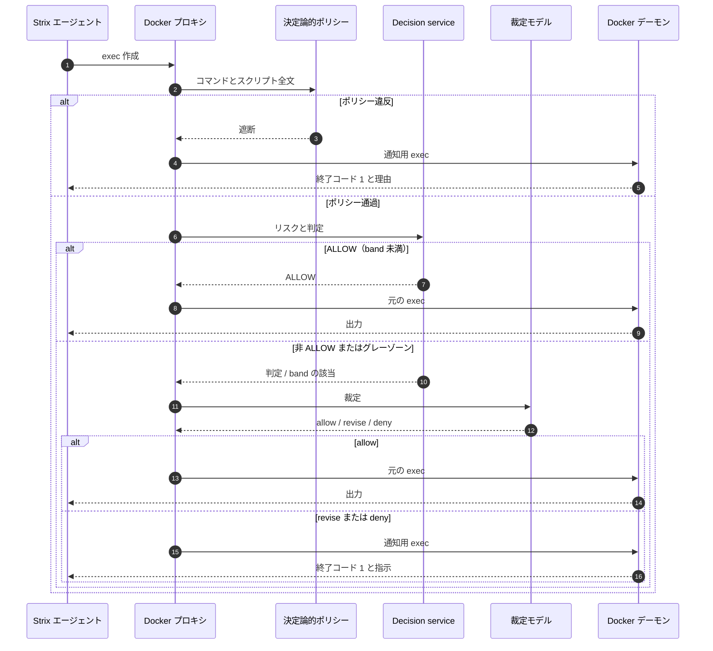
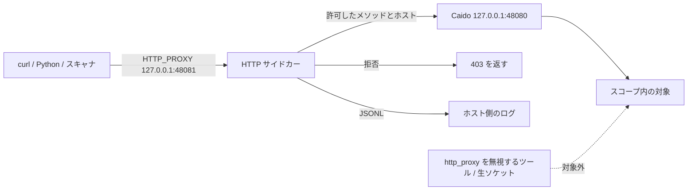
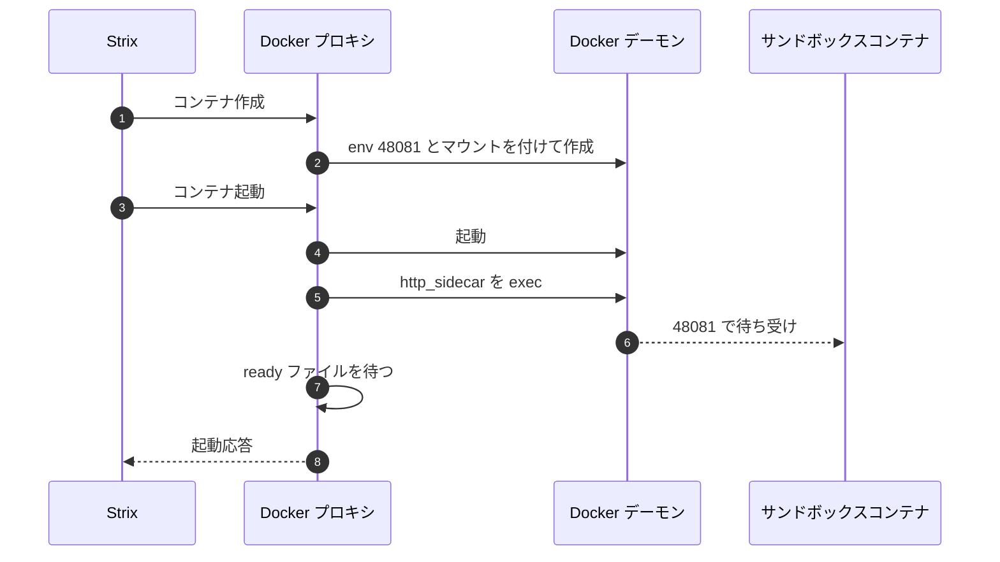

# strix-guard

[English](README.md) | **日本語**

strix-guard は、Strix の実行を変えずに、コマンドと HTTP リクエストにポリシーを課すアドインです。Strix 本体、プロンプト、サンドボックスイメージには手を入れません。

> 許可されたテストにだけ使ってください。対象の範囲と権限は利用者が管理します。

## 目次

- [課題](#課題)
- [解決策](#解決策)
  - [アーキテクチャ](#アーキテクチャ)
- [実際にどう制御するのか](#実際にどう制御するのか)
  - [exec ゲート](#1-exec-ゲート)
  - [決定論的ポリシー](#2-決定論的ポリシー)
  - [リスク評価と強モデル](#3-リスク評価と強モデル)
  - [HTTP サイドカー](#4-http-サイドカー)
- [使い方](#使い方)
- [テスト](#テスト)
- [対象と制限](#対象と制限)
- [ドキュメント](#ドキュメント)

## 課題

攻撃者は、AI エージェントを使ってアプリケーションの脆弱性を探すようになっています。同じツールと同じモデルを対象へ向け、破壊的な試行も含めて試せます。失敗しても、対象を壊しても、攻撃者の側に大きなコストはかかりません。

防御側も、攻撃者と同じ目線を持つ必要があります。同じツールと同じモデルを使い、外部の攻撃者なら見つける問題を見つけ、リスクに応じて直し、リリースする。モデルが進化すれば、これまで見つからなかった問題が見つかる可能性があります。だから、一度きりではなく、リリースのたびに、モデルの更新のたびに続ける必要があります。

ここに非対称性があります。攻撃者は、テーブルを落とす、ファイルを上書きする、アカウントをロックする、といった破壊的な操作を試し、その結果を証拠にできます。防御側は同じエージェントを本番に近い環境へ向けるわけにはいきません。テストは非破壊でなければならない。読み取りを基本にし、書き込みはテストデータとテストアカウントに限定し、リクエスト数に上限を設け、変更した状態は戻す。そのうえで、エージェントがその約束を守ったことを示す必要があります。

プロンプトだけでは、これを保証できません。次のコマンドを決めるのはエージェントで、モデルは破壊的な経路や、スクリプトに隠れた書き換えメソッドを見落とすことがあります。遮断したなら、エージェントが次に動ける理由を返す必要があります。実行後には、何を試し、何を止め、何が対象に届いたかを示す証拠が要ります。

非対称性の例:

- 攻撃者は `DROP TABLE` や管理者アカウントの削除で影響を示せます。防御側も同じ証拠が要りますが、データを壊したままにはできません。使い捨てのレコードで試し、元に戻すか、読み取りだけの証拠で止めます。
- 攻撃者は10万回のログイン試行を送れます。防御側はレート制限が効くかを知りたいが、試行は上限で止め、実ユーザーをロックアウトさせない必要があります。
- 攻撃者はウェブシェルをアップロードできます。防御側はアップロード処理を試したいが、ペイロードを実行せず、ファイルも残さない必要があります。
- 攻撃者はエージェントを第三者のホストへ向けられます。防御側は宣言したスコープの外へ出さず、出ていないことを示す必要があります。
- 攻撃者は新しいモデルが出たらすぐ使えます。防御側はモデル更新のたびに同じ検査を再実行し、同じポリシーと再現可能な記録を残す必要があります。

## 解決策

strix-guard は、この非対称性の中で防御側が使うための制御層です。Strix に手を入れずに、二つの制御点を追加します。

1. **Docker API プロキシ**。ランチャーがローカルプロキシを起動し、Strix プロセスの `DOCKER_HOST` をそこへ向けます。コンテナの作成、起動、exec はすべてプロキシを通ります。プロキシはコマンドを読み、ポリシーを確認し、そのまま転送するか、通知に差し替えます。差し替えたとき、元のコマンドは実行されません。
2. **コンテナ内 HTTP サイドカー**。`reference_only` と `recon` では、サンドボックスの中で小さなプロキシを起動します。コンテナの `http_proxy` はこのサイドカーを指し、サイドカーは Strix が使う Caido プロキシへ転送します。コマンド検査では見えない、実行時に組み立てられたメソッドもここで止まります。

### アーキテクチャ


図は二つの信頼境界を示しています。ホスト側のパイプラインがコマンドのポリシーとモデル裁定を担当し、サンドボックス内のサイドカーがHTTPメソッドとホストの制限を担当します。各箱とコードの対応は下の表にあります。

| 層 | 動作する場所 | 役割 | コード |
|---|---|---|---|
| ランチャー | ホスト | ポリシー解決、セットアップ、環境変数、UI、監査 | `strix_guard/launcher.py` |
| Docker API プロキシ | ホスト | コンテナ作成・起動・exec のフック、通知への差し替え | `strix_guard/docker_proxy.py` |
| 台帳 | ホスト | `apply_patch`、heredoc、`cp`、`mv` からスクリプトを復元 | `strix_guard/ledger.py` |
| 決定論的ポリシー | ホスト | メソッド、アップロード、SQL 書き込み、外部通信、ツールの検査 | `strix_guard/policy_guard.py`、`strix_guard/policy_config.py` |
| Decision service | ホスト | JEV のリスク評価と Policy Engine の判定 | `strix_guard/decision.py`、`strix_guard/policy.py` |
| 裁定モデル | ホスト | 非 ALLOW とグレーゾーンの再審査、フォールバック | `strix_guard/adjudicator.py` |
| サイドカーマネージャ | ホスト | サイドカーの準備、env と bind の注入、起動 | `strix_guard/sidecar_manager.py` |
| HTTP サイドカー | サンドボックス | メソッド、ホスト、回数、レート、並列の制限、JSONL ログ | `strix_guard/http_sidecar.py` |
| 監査 | ホスト | 判定、ポリシースナップショット、サイドカーログ | `strix_guard/audit.py` |

ガードはホストで動き、Docker ソケットを使います。HTTP サイドカーはサンドボックスの中で動きます。サイドカーのポリシーファイルは読み取り専用でマウントし、ログはホスト側のディレクトリへ書きます。モデルの呼び出しは、設定したプロバイダへ出ます。Strix 本体は変更しません。

ハードポリシーの確認は、モデルを呼ぶ前に済ませます。モデルは曖昧な判断と、エージェントへの修正指示を担当します。モデルだけに実行の可否を任せません。

## 実際にどう制御するのか

### 1. exec ゲート

プロキシは `POST /containers/{id}/exec` を見て、判定を行います。結果は三つです。

- **許可**。exec リクエストをそのまま転送します。HTTP サイドカーが有効なときは、exec の環境変数もサイドカーへ向けます。
- **修正**。エージェントにコマンドを変えさせます。ガードは、指示を表示して終了コード 1 を返す exec に差し替えます。
  ```sh
  sh -c "printf '%s\n' '<指示>'; exit 1"
  ```
  元のコマンドは実行されません。
- **拒否**。同じ差し替えで、遮断の理由を返します。



Strix の PTY ラッパーがあるときは、そのラッパーを残して通知を差し込みます。これで、Strix が出力を拾える場面では、エージェントが通知を読めます。Strix が非 TTY の exec で空の出力を返す場合でも、終了コード 1 は伝わります。本文は監査ログに残ります。

### 2. 決定論的ポリシー

`reference_only` と `recon` では、JEV を呼ぶ前に、コマンドと台帳から復元したスクリプト全文を確認します。

止める対象:

- 許可リストにない HTTP メソッド（`curl -X`、`-d`、`-F`、`-T`、`wget --post-*`、`requests` / `httpx` / `axios` / `session` の呼び出し、`fetch(..., {method})`、`ffuf -X` など）
- ファイルのアップロード
- SQL の書き込み（`INSERT`、`UPDATE`、`DELETE FROM`、`DROP TABLE`、`TRUNCATE`、`ALTER TABLE`）
- `egress.allow_external` が false のときの外部通信
- `recon` での攻撃ツール

Strix 自身のプロキシ（`127.0.0.1:48080`）は `egress.infra_hosts` に入れています。このホストだけを触るコマンドはインフラ操作として扱い、対象へのメソッド制限をかけません。

### 3. リスク評価と強モデル

JEV は、破壊性、負荷、データ露出、スコープ違反、第三者への影響の五つと、情報が足りているかを返します。Policy Engine がしきい値を当てはめ、最終的な判定を出します。

強モデルを呼ぶのは、次の場合だけです。

- **非 ALLOW の判定**（`REVISE`、`HOLD`、`NEED_INFO`）は裁定モデルへ渡します。
- **ハードブロック**はエージェントに通知します。`--adjudicator-review-blocks` を付けると再審査の結果を監査に残しますが、判定は変えられません。ソフトブロックだけは、確信度が高いときに下げられます。
- **グレーゾーン**。どのしきい値にも届かないものの、`review_band` を超えたコマンドは、助言のため裁定モデルへ渡します。既定値は `full` が 0.30、`reference_only` と `recon` が 0.25 です。

裁定モデルの既定の順番:

```text
openai/gpt-6-sol → google/gemini-3.8-flash → anthropic/claude-opus-4.6
```

フォールバックが必要なのは、プロバイダがセキュリティ関連の内容を拒否する場合があるからです。最初のモデルが `cyber_policy` で拒否したら、次のモデルが同じ内容を審査します。すべて失敗したら、コマンドは拒否されます。グレーゾーンの再審査が失敗した場合は、ポリシーがすでに ALLOW を出しているので実行し、エラーを監査に残します。

| 状況 | 判定 | 強モデル | 実行 |
|---|---|---|---|
| 決定論的ポリシー違反 | `BLOCK`（`policy_rule`） | 呼ばない | しない |
| ハードブロック | `BLOCK` | 再審査は任意。ダウングレード不可 | しない |
| ソフトブロック | `BLOCK` | 再審査。確信度 0.8 以上で allow / revise | 場合による |
| `REVISE` / `HOLD` / `NEED_INFO` | 非 ALLOW | 裁定 | allow / revise / deny |
| `ALLOW` で `review_band` 以上 | `ALLOW` | グレーゾーン再審査 | allow / revise / deny |
| `ALLOW` で band 未満 | `ALLOW` | 呼ばない | する |
| JEV の失敗 | ヒューリスティック | 上と同じ | 上と同じ |
| すべての裁定モデルが失敗 | 非 ALLOW | 失敗 | しない |
| グレーゾーン再審査が失敗 | `ALLOW` | 失敗 | する。記録を残す |

### 4. HTTP サイドカー

exec の検査では、実行時に組み立てられたメソッドを見つけられません。たとえば、次のコマンドです。

```sh
python3 -c "import requests; m='PO'+'ST'; requests.request(m, 'http://host.docker.internal:5000/login')"
```

`reference_only` と `recon` では、コンテナの起動後に `http_sidecar.py` をコンテナ内で起動します。サイドカーは次の動きをします。

- `127.0.0.1:48081` で待ち受ける
- コンテナの `http_proxy`、`https_proxy`、`ALL_PROXY` を受け取る
- Strix の Caido プロキシ（`127.0.0.1:48080`）へ転送する
- 許可したメソッドとホストだけを通す
- `max_requests`、`max_rps`、`max_parallel` を守らせる
- JSONL のアクセスログを、ホストにマウントしたディレクトリへ書く

`NO_PROXY` には `localhost`、`127.0.0.1`、`api.caido.io` を入れています。Strix 自身のプロキシやテレメトリが、サイドカーへ戻らないようにするためです。



サイドカーが制御できるのは、プロキシの環境変数に従う通信だけです。環境変数を無視するツールや生のソケットは迂回できます。参照のみを確実に守るなら、読み取り専用の資格情報か、対象側のネットワーク制御を使ってください。



`reference_only` では HTTPS の CONNECT を既定で拒否します。CONNECT のトンネルの中はメソッドが見えないからです。この制限を受け入れる場合だけ、`"allow_connect": true` にしてください。

### 5. 監査と再現性

実行ごとに、`guard_runs/run-<timestamp>/` へ監査ファイルを書きます。

- `verdicts.jsonl` — 評価、アクション、裁定、グレーゾーン再審査、ブロック再審査、サイドカーのイベント
- `policy.json` — 解決後のポリシースナップショット
- `http-*.jsonl` — HTTP サイドカーのアクセスログ（実行後にコピー）

ランチャーは起動時にポリシーの SHA-256 の先頭を表示します。同じポリシーと同じ引数なら、同じ判断規則で再現できます。

### 6. 失敗したときの動き

- JEV のエラー: ヒューリスティックの評価に切り替えます。
- 裁定モデルのエラーやプロバイダの拒否: 次のフォールバックモデルを試します。すべて失敗したら exec を拒否します。
- グレーゾーン再審査のエラー: ポリシーが ALLOW を出しているので実行し、エラーを記録します。
- サイドカーの起動失敗: 監査に記録します。コンテナのプロキシはサイドカーを指したままなので、サイドカーが使えるまでの対象リクエストは失敗します。この実行は HTTP 制御が効いていないものとして扱ってください。
- 非 TTY の exec 出力: Strix は許可したコマンドでも空の出力を返すことがあります。終了コードで遮断か成功かを判断し、本文は監査ログで確認してください。

## 使い方

### 必要なもの

- Python 3.10 以上（新しい型ヒントを使っています）
- Strix が実行できること（`~/.strix/bin/strix` か、`PATH` 上の `strix`）
- Docker ソケット（`/var/run/docker.sock`）と Docker CLI
- tmux（ポップアップ承認を使う場合。任意）

インストールするパッケージはありません。プロジェクトのルートで実行します。

```bash
cd strix_guard
python3 -m unittest discover -s tests
```

### 最短の起動: セットアップウィザード

```bash
python3 -m strix_guard.launcher --setup -- \
  --target http://host.docker.internal:5000
```

ウィザードは、環境、テスト方針、裁定モード、言語、PII 方針、モデル、タイムアウト、テストアカウントを聞きます。production の既定は `reference_only` です。

### 非対話の自動裁定

```bash
python3 -m strix_guard.launcher \
  --ui noninteractive --on-ask deny \
  --adjudicator auto --adjudicator-review-blocks \
  --pii-policy test_data_ok \
  -- --target http://host.docker.internal:5000 --non-interactive
```

Strix の既定（`deep`、エージェントごとのターン上限 500、予算上限なし）をそのまま使います。実行を区切りたいときは、`--` の後ろに Strix の引数を渡します。

```bash
python3 -m strix_guard.launcher \
  --ui noninteractive --adjudicator auto \
  -- --target http://host.docker.internal:5000 --non-interactive \
  --scan-mode standard --max-turns 30 --max-budget 2.0
```

### 参照のみのテスト

```bash
python3 -m strix_guard.launcher \
  --ui noninteractive --adjudicator auto --adjudicator-review-blocks \
  --policy-preset reference_only \
  -- --target http://host.docker.internal:5000 --non-interactive
```

`reference_only` は HTTP サイドカーを有効にします。`GET`、`HEAD`、`OPTIONS` だけを通し、アップロードと SQL の書き込み、外部通信を止めます。`recon` も同様ですが、レート上限が低く、攻撃ツールを使いません。

exec のルールは残したまま、サイドカーだけを止める場合:

```bash
--policy-preset reference_only --no-http-enforce
```

### カスタムポリシー

```bash
python3 -m strix_guard.launcher \
  --policy ./guard_policy.json \
  --ui noninteractive --adjudicator auto \
  -- --target http://host.docker.internal:5000 --non-interactive
```

`guard_policy.json` の例:

```json
{
  "version": 1,
  "preset": "reference_only",
  "review_band": {
    "destructiveness": 0.30,
    "load": 0.30,
    "data_exposure": 0.30,
    "scope_violation": 0.30,
    "third_party": 0.30
  },
  "http": {
    "enforce": true,
    "allowed_methods": ["GET", "HEAD", "OPTIONS"],
    "max_requests": 500,
    "max_parallel": 10,
    "max_rps": 10,
    "allow_uploads": false,
    "allow_connect": false
  },
  "egress": {
    "allow_external": false,
    "allowed_hosts": ["host.docker.internal:5000"],
    "infra_hosts": ["127.0.0.1:48080", "localhost:48080"]
  },
  "data": {
    "allowed_test_accounts": ["alice", "bob"],
    "allow_other_accounts": false,
    "allow_writes": false,
    "restore_after_write": true
  }
}
```

ポリシーの読み込み順:

1. `--policy FILE`
2. `STRIX_GUARD_POLICY`
3. `./guard_policy.json`
4. `~/.config/strix-guard/policy.json`
5. 選択したプリセット

知らないキーがあると、起動時にエラーになります。解決後のポリシーは `guard_runs/<run>/policy.json` に保存します。

### グレーゾーン再審査

裁定モデルを有効にすると、グレーゾーン再審査も既定で有効になります。

```bash
# 既定: review_band 以上の ALLOW を再審査する
--policy-preset reference_only --adjudicator auto

# 再審査を止める
--policy-preset reference_only --adjudicator auto --no-gray-review
```

次元ごとの band はポリシーファイルで指定します。`0` にすると、その次元は再審査しません。

### フォールバックモデル

```bash
--adjudicator-model openai/gpt-6-sol \
--adjudicator-fallback-models google/gemini-3.8-flash,anthropic/claude-opus-4.6
```

### テストアカウントと PII

```bash
--test-accounts "alice,bob" --pii-policy test_data_ok
```

`benchmark` と `test_data_ok` の組み合わせでは、シードアカウントとエージェントが作ったアカウントをテストデータとして扱い、データ露出のリスクを抑えます。`strict` は staging と production 向けの通常の PII 方針です。

### 承認 UI

```bash
# tmux ポップアップ（TTY での既定）
--ui tmux

# ブラウザの承認ページ
--ui web

# CLI の質問
--ui cli

# 人間を置かず、自動裁定か拒否にする
--ui noninteractive --on-ask deny
```

### dry-run、ゲート検証、リプレイ

```bash
# Strix を起動せず、Docker プロキシとポリシーだけを動かす
python3 -m strix_guard.launcher --dry-run --policy-preset reference_only

# 遮断・修正したコマンドが対象へ届いていないことをアクセスログで確かめる
python3 tools/verify_gate.py

# コマンドカタログを判定パイプラインに通す
python3 -m strix_guard.replay <exec_cmds.jsonl> --limit 20
```

### 環境プロファイル

```bash
--environment benchmark   # 使い捨ての検証環境
--environment staging     # 実データに近い検証環境
--environment production  # 本番。ポリシーの既定は reference_only
```

プロファイルは、PII 方針、裁定モード、承認タイムアウト、しきい値の倍率、コスト上限を決めます。セットアップウィザードも同じプロファイルを使います。

### 監査ファイル

```text
guard_runs/run-20261101-145329/
  verdicts.jsonl       判定、アクション、グレーゾーン再審査、サイドカーイベント
  policy.json          解決後のポリシー
  http-2b6e....jsonl   HTTP サイドカーのアクセスログ
```

### 困ったとき

- `policy error: unknown ...` — JSON に知らないキーがあります。削るか、つづりを直してください。
- `http sidecar setup failed` — Docker デーモンがキャッシュディレクトリを読めるか、バインドマウントできるかを確認してください。サイドカーは `~/.cache/strix-guard-http-*` に置かれます。
- エージェントが「出力がない」と言う — Strix は非 TTY の exec で空の出力を返すことがあります。終了コード 1 と監査ログを確認してください。コマンドは遮断され、実行されていません。
- `reference_only` で HTTPS が通らない — CONNECT の中はメソッドが見えません。この制限を受け入れる場合だけ `allow_connect` を `true` にしてください。
- `--target-list` の対象がサイドカーの許可リストにない — ポリシーファイルの `egress.allowed_hosts` に追加してください。サイドカーは CLI の対象 URL とこのリストを読みます。
- プロバイダがセキュリティ内容を拒否する — フォールバックモデルが同じ内容を審査します。すべて失敗したらコマンドは拒否され、プロバイダのエラーが監査に残ります。

## テスト

ユニットテストと統合テストは 120 件です。

```bash
python3 -m unittest discover -s tests
```

対象は、Policy Engine、JEV 連携、裁定モデルのフォールバック、Docker プロキシの差し替え、実 Docker API、台帳（`apply_patch`、heredoc、`cp`、`mv`）、HTTP サイドカー、サイドカーマネージャ、セットアップウィザード、Web UI、承認ブローカーです。

実行結果の詳細とテストマトリクスは [docs/TEST_REPORT.md](docs/TEST_REPORT.md) に、機能要件は [docs/REQUIREMENTS.md](docs/REQUIREMENTS.md) にあります。

主な結果:

- 標準の auto 裁定run: exec 評価 631 件、裁定 6 回、検出 19 件。
- 既定の `deep` run（ターン上限・予算上限の指定なし）: 評価 845 件、裁定 9 回、検出 17 件、$0.87。
- `tools/verify_gate.py`: 5 項目すべて PASS。許可したリクエストだけが対象へ届き、遮断・修正・スクリプト内容の各ケースはアクセス 0 件でした。
- `m='PO'+'ST'` で組み立てた `POST` は exec 検査を通り、HTTP サイドカーが `method_not_allowed` で止めました。

## 対象と制限

- strix-guard はサンドボックスでもネットワークファイアウォールでもありません。`http_proxy` を無視するツール、生のソケット、直接の通信は、HTTP サイドカーを迂回できます。参照のみを確実に守るなら、読み取り専用の資格情報か、対象側のネットワーク制御を使ってください。
- ガードは Docker API とホストを信頼します。ホストが侵害されると迂回できます。
- モデルの判断は助言です。ハードポリシーと HTTP サイドカーが強制の層です。
- CONNECT のトンネルは、TLS を傍受しない限りメソッドを検査できません。
- サイドカーは、Strix のサンドボックスイメージ内の Python（`python3`）に依存します。
- Strix は非 TTY の exec で空の出力を返すことがあります。ガードからは変えられません。コマンドと判定は監査に残ります。

## ドキュメント

- [docs/REQUIREMENTS.md](docs/REQUIREMENTS.md) — 機能要件と非機能要件
- [docs/TEST_REPORT.md](docs/TEST_REPORT.md) — テストマトリクス、実行結果、既知の失敗
- [DESIGN.md](DESIGN.md) — 設計メモと背景
