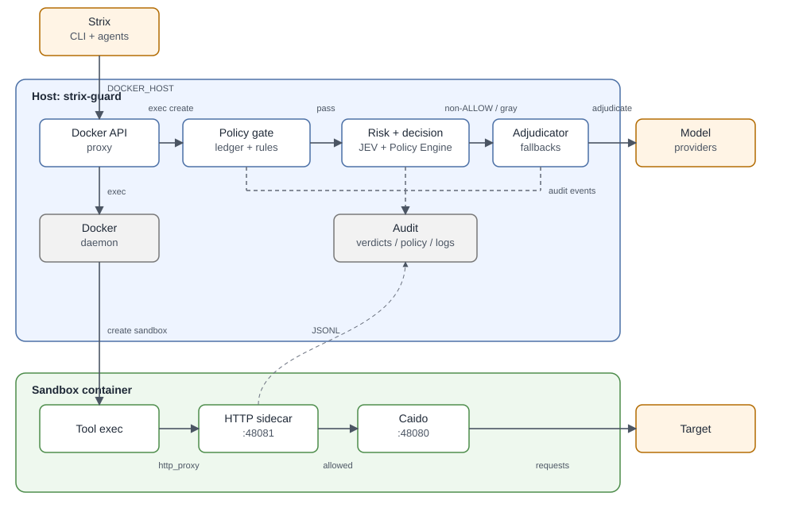
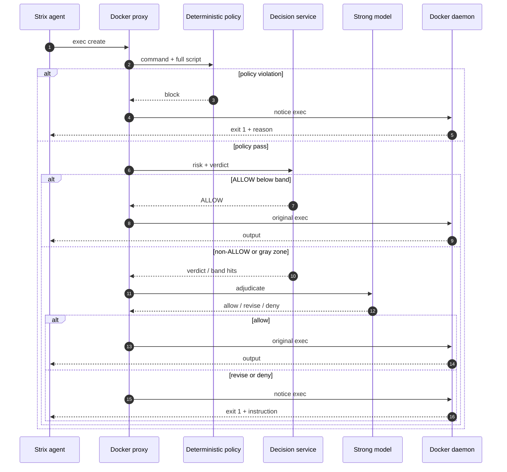
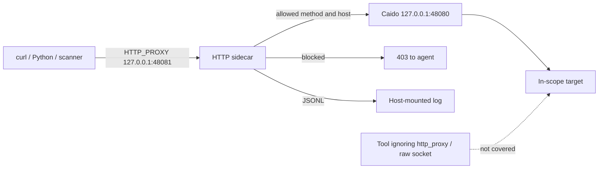
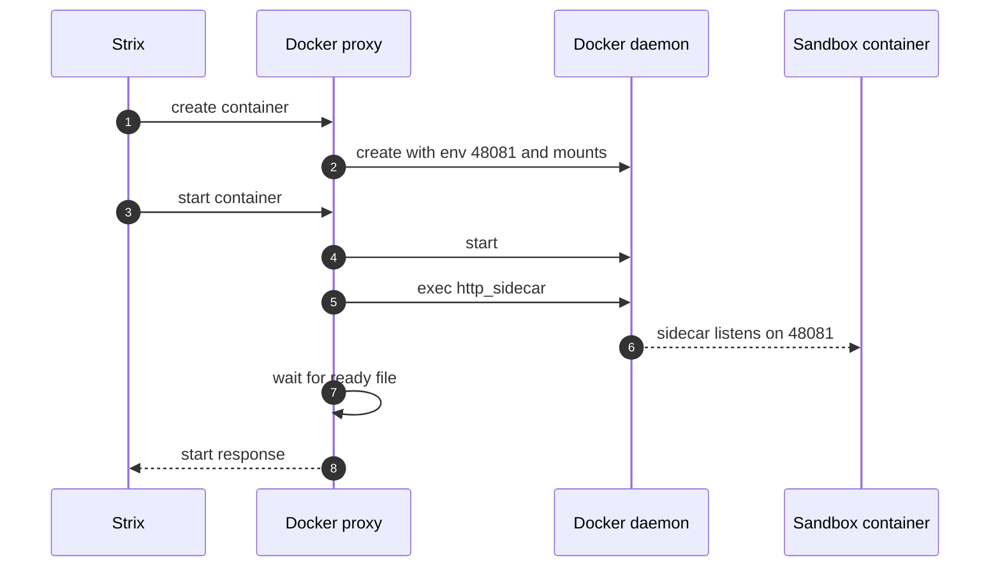

# strix-guard

**English** | [日本語](README.ja.md)

[Strix](https://strix.ai) is an autonomous penetration-testing agent. It is used in real offensive operations, not only in lab exercises. strix-guard is a non-invasive policy and safety layer for Strix. It gates every `exec_command` before the command reaches the sandbox, sends ambiguous cases to a strong model, and can enforce HTTP methods and request limits from inside the sandbox. It does not modify Strix, its prompts, or its sandbox image.

> Use this only for authorized security testing. You are responsible for scope, permission, and the impact of the scan.

## Contents

- [Problem](#problem)
  - [What historical runs show](#what-historical-runs-show)
- [Solution](#solution)
  - [Architecture](#architecture)
- [How it enforces control](#how-it-enforces-control)
  - [Exec gate](#1-exec-gate)
  - [Deterministic policy](#2-deterministic-policy)
  - [Risk assessment and the strong model](#3-risk-assessment-and-the-strong-model)
  - [HTTP sidecar](#4-http-sidecar)
- [Usage](#usage)
  - [Launcher options](#launcher-options)
  - [Policy presets](#policy-presets)
- [Tests](#tests)
- [Scope and limitations](#scope-and-limitations)
- [Documentation](#documentation)

## Problem

Attackers increasingly use AI agents to find application vulnerabilities. They can point the same tools and models at a target and let the agent try destructive paths. A failed attempt, or a damaged target, costs them little.

Defenders need the same attacker's-eye view. They need to use the same tools and models, find what an external attacker would find, fix it by risk, and release. As models improve, the set of findable issues changes, so the work continues after every release and every model upgrade.

The two sides are not symmetric. An attacker can drop a table, overwrite a file, or lock an account and treat the damage as part of the test. A defender cannot. The test has to stay non-destructive: read-only where possible, writes limited to test data and accounts, request volume bounded, and state restored. The defender also has to prove the agent stayed inside those limits.

That is not something a prompt can guarantee. The agent chooses the next command, and the model can miss a destructive path or a mutating HTTP method hidden in a script. A blocked command needs a reason the agent can act on. After the run, the team needs evidence of what was attempted, what was blocked, and what reached the target.

Examples of the asymmetry:

- An attacker can run `DROP TABLE` or delete an admin account to prove impact. A defender needs the same proof but cannot leave the data destroyed. The test has to use a disposable record and restore it, or stop at a read-only proof.
- An attacker can send 100,000 login attempts. A defender needs to know whether rate limiting works, but must stop at a bounded number and avoid locking out real users.
- An attacker can upload a webshell. A defender needs to test upload handling without executing a payload or leaving a file behind.
- An attacker can point the agent at any third-party host. A defender must keep the agent inside the declared scope and show that it stayed there.
- An attacker can adopt a new model as soon as it ships. A defender needs to re-run the same checks after each model upgrade, with the same policy and a reproducible record.

### What historical runs show

The asymmetry is not hypothetical. We re-scored every exec attempt from 136 earlier Strix benchmark runs (39,830 commands, with script contents rebuilt from the ledger) using JEV. Those runs had no guard in place, so the commands below ran:

- **2,740 commands (6.9%)** crossed the danger thresholds: 1,965 exposed data, 433 were destructive, 417 imposed high load, 10 attacked third parties, and 1 left the declared scope (categories can overlap).
- That is an average of **20.1 dangerous commands per run** (median 16); runs with 200+ commands averaged **26.1**.
- **1,062** of the dangerous commands were only visible after the ledger rebuilt the script hidden inside a PTY file-transfer wrapper (token theft, bulk signup, and similar payloads).
- With the guard in place the picture changes: across 29 guarded runs, 115 dangerous attempts were logged; the guard blocked or revised 81, and 34 ran because the selected policy permitted them. `reference_only` stops those before execution.

Left alone, the agent routinely reads other users' data and pushes load at the target. That is why enforcement has to live outside the model, in the exec gate and the HTTP sidecar. The method and full breakdown are in the [JEV corpus report](docs/JEV_CORPUS_REPORT.md).

## Solution

strix-guard is the control layer for the defender's side of this asymmetry. It inserts two enforcement points without touching Strix.

1. **Docker API proxy.** The launcher starts a local proxy and sets `DOCKER_HOST` for the Strix process. Every container create, start, and exec call passes through it. The proxy reads the command, checks the policy, and either forwards the command or replaces it with a notice. The original command is never executed.
2. **In-container HTTP sidecar.** For the read-only presets (`reference_only` and `recon`; details in [Policy presets](#policy-presets)), the guard starts a small proxy inside the sandbox. The container's `http_proxy` points to the sidecar, and the sidecar chains to Strix's existing Caido proxy. It enforces allowed methods, hosts, request counts, and rates even when the command uses an obfuscated method that the exec check cannot see.

### Architecture



The diagram shows the two trust boundaries. The host pipeline handles command policy and model review. The sandbox sidecar handles HTTP method and host enforcement. The table below maps each box to its code.

| Layer | Runs in | Responsibility | Code |
|---|---|---|---|
| Launcher | Host | policy resolution, setup, environment, UI, audit | `strix_guard/launcher.py` |
| Docker API proxy | Host | container create/start/exec hooks, notice rewrite | `strix_guard/docker_proxy.py` |
| Ledger | Host | rebuild scripts from `apply_patch`, heredoc, `cp`, `mv` | `strix_guard/ledger.py` |
| Deterministic policy | Host | method, upload, SQL write, egress, tool rules | `strix_guard/policy_guard.py`, `strix_guard/policy_config.py` |
| Decision service | Host | JEV risk and Policy Engine verdict | `strix_guard/decision.py`, `strix_guard/policy.py` |
| Adjudicator | Host | non-ALLOW and gray-zone review, fallback chain | `strix_guard/adjudicator.py` |
| Sidecar manager | Host | prepare sidecar, inject env/binds, start it | `strix_guard/sidecar_manager.py` |
| HTTP sidecar | Sandbox | method, host, request, rate, and parallel limits; JSONL log | `strix_guard/http_sidecar.py` |
| Audit | Host | verdicts, policy snapshot, sidecar logs | `strix_guard/audit.py` |

The guard runs on the host and talks to the Docker socket. The HTTP sidecar runs inside the sandbox; its policy file is mounted read-only and its log is written to a host-mounted directory. Model calls leave the host to the configured provider. Strix itself is not modified.

All hard policy checks run before the models. The models handle ambiguity and write instructions for the agent; they are not the enforcement mechanism.

## How it enforces control

### 1. Exec gate

The proxy sees `POST /containers/{id}/exec` and calls the decision pipeline. Three outcomes are possible.

- **Allow.** The exec request is forwarded. When the HTTP sidecar is active, the exec environment also points at the sidecar.
- **Revise.** The agent must change the command. The guard returns a new exec that prints the instruction and exits with code 1.
  ```sh
  sh -c "printf '%s\n' '<guard instruction>'; exit 1"
  ```
  The original command never runs.
- **Deny.** Same rewrite, with a hard block message.



The rewrite preserves Strix's PTY wrapper when it is present, so the notice can reach the agent through the normal tool output. If Strix itself returns an empty output for a non-TTY session, the agent still sees exit code 1; the text remains in the audit log.

### 2. Deterministic policy

For `reference_only` and `recon`, the guard checks the command and the full script text from the ledger before it calls JEV.

It blocks or holds:

- HTTP methods outside the allowlist (`curl -X`, `-d`, `-F`, `-T`, `wget --post-*`, `requests/httpx/axios/session` calls, `fetch(..., {method})`, `ffuf -X`, and similar)
- file uploads
- SQL writes (`INSERT`, `UPDATE`, `DELETE FROM`, `DROP TABLE`, `TRUNCATE`, `ALTER TABLE`)
- external egress when `egress.allow_external` is false
- exploitation tools in `recon`

Strix's own proxy (`127.0.0.1:48080`) is in `egress.infra_hosts`. Commands that only touch that host are treated as infrastructure and are not subject to the target method policy.

### 3. Risk assessment and the strong model

JEV is a fast, very cheap decision model from Typesafe. It scores a command on a fixed set of risk dimensions, so strix-guard can run it on every exec without a noticeable delay or cost, and the expensive adjudicator is reserved for non-ALLOW and gray-zone cases. A JEV decision costs roughly $0.00002–0.00005, so the check fits into the normal agent loop without hurting the testing experience. See [Introducing System One models and JEV](https://typesafe.ai/blog/introducing-system-one-models-and-jev) (the post calls this class of models "System One").

JEV returns five risk dimensions: destructiveness, load, data exposure, scope violation, and third-party impact, plus a sufficiency answer. The Policy Engine applies thresholds and produces the verdict.

The strong model is called only when needed:

- **Non-ALLOW verdicts** (`REVISE`, `HOLD`, `NEED_INFO`) go to the adjudicator.
- **Hard blocks** are reported to the agent; `--adjudicator-review-blocks` records a second opinion but cannot downgrade them. Soft blocks can be downgraded at high confidence.
- **Gray zone.** If a command is below every policy threshold but above `review_band`, it is sent to the adjudicator as an advisory review. The default band is 0.30 for `full` and 0.25 for `reference_only` and `recon`.

The default adjudicator chain is:

```text
openai/gpt-6-sol → google/gemini-3.8-flash → anthropic/claude-opus-4.6
```

The fallback matters because providers can refuse security content. If the primary returns a `cyber_policy` refusal, the next model reviews the same payload. If every model fails, the command is denied. A gray-zone review that fails is allowed, because the policy already returned ALLOW, and the error is recorded.

| Situation | Verdict | Strong model | Executed |
|---|---|---|---|
| Deterministic policy violation | `BLOCK` (`policy_rule`) | no | no |
| Hard block | `BLOCK` | optional review, no downgrade | no |
| Soft block | `BLOCK` | review; allow/revise at confidence ≥ 0.8 | maybe |
| `REVISE` / `HOLD` / `NEED_INFO` | non-ALLOW | adjudicate | allow/revise/deny |
| `ALLOW` above `review_band` | `ALLOW` | gray-zone review | allow/revise/deny |
| `ALLOW` below band | `ALLOW` | no | yes |
| JEV failure | heuristic risk | as above | as above |
| All adjudicators fail | non-ALLOW | failed | no |
| Gray review fails | `ALLOW` | failed | yes, logged |

### 4. HTTP sidecar

The exec check cannot see a method built at runtime, for example:

```sh
python3 -c "import requests; m='PO'+'ST'; requests.request(m, 'http://host.docker.internal:5000/login')"
```

For `reference_only` and `recon`, the guard starts `http_sidecar.py` inside each sandbox container after the container starts. The sidecar:

- listens on `127.0.0.1:48081`
- receives the container's `http_proxy`, `https_proxy`, and `ALL_PROXY`
- chains to Strix's Caido proxy at `127.0.0.1:48080`
- allows only the configured HTTP methods and hosts
- enforces `max_requests`, `max_rps`, and `max_parallel`
- writes a JSONL access log to a host-mounted directory

`NO_PROXY` includes `localhost`, `127.0.0.1`, and `api.caido.io`, so Strix's own proxy and telemetry do not loop back through the sidecar.



The sidecar covers traffic that honors the proxy environment. Tools that ignore it, and raw sockets, can bypass it. For a hard read-only guarantee, use read-only credentials or network egress rules at the target.



HTTPS CONNECT is blocked by default for `reference_only`. A CONNECT tunnel hides the method from the sidecar. Set `"allow_connect": true` only when you accept that limitation.

### 5. Audit and reproducibility

Each run writes an audit directory under `guard_runs/run-<timestamp>/`:

- `verdicts.jsonl` — evaluations, actions, adjudications, gray reviews, block reviews, sidecar events
- `policy.json` — the resolved policy snapshot
- `http-*.jsonl` — HTTP sidecar access logs, copied after the run

The launcher prints the policy SHA-256 prefix at startup. The same policy and target arguments reproduce the same decision rules.

### 6. What happens when something fails

- JEV error: the heuristic fallback is used.
- Adjudicator error or provider refusal: the next fallback model is tried; if all fail, the exec is denied.
- Gray review error: the command is allowed and the error is recorded, because the policy already passed it.
- Sidecar start error: recorded in the audit. The container's proxy still points at the sidecar, so target requests through it will fail until the sidecar is available. Treat that run as not HTTP-enforced.
- Non-TTY exec output: Strix may return empty output even for allowed commands. The exit code still distinguishes a block from a success. TTY commands show the text.

## Usage

### Requirements

- Python 3.10 or newer (the code uses modern type hints)
- Strix installed and able to run (`~/.strix/bin/strix` or `strix` on `PATH`)
- Docker socket access (`/var/run/docker.sock`) and the Docker CLI
- `tmux` for the popup approval UI; optional

There is no package to install. Run from the project root:

```bash
cd strix_guard
python3 -m unittest discover -s tests
```

### Launcher options

Run `python3 -m strix_guard.launcher --help` for the same list. Strix's own flags go after `--` and are passed through unchanged (`strix --help` lists them).

| Category | Option | Default | Description |
|---|---|---|---|
| Run | `--runs-dir DIR` | `./strix_runs` | Where Strix keeps per-run state (the ledger reads it) |
| Run | `--audit-dir DIR` | `~/blackbox-testing/strix_guard/guard_runs` | Parent directory for `run-<timestamp>/` audit folders |
| Run | `--dry-run` | off | Start the Docker proxy and policy pipeline without launching Strix |
| Policy | `--policy-preset NAME` | `full` | Testing stance: `full`, `reference_only`, or `recon` (see [Policy presets](#policy-presets)) |
| Policy | `--policy FILE` | none | JSON policy file; overrides the preset (highest priority) |
| Policy | `--no-http-enforce` | off | Keep the exec rules but do not start the in-container HTTP sidecar |
| Policy | `--environment NAME` | `benchmark` | Environment profile for PII defaults and threshold scaling |
| Policy | `--pii-policy NAME` | `test_data_ok` | `test_data_ok` caps test-account data risk; `strict` keeps full PII risk |
| Policy | `--test-accounts LIST` | empty (or `STRIX_GUARD_TEST_ACCOUNTS`) | Comma-separated accounts the agent may read or write |
| Adjudicator | `--adjudicator MODE` | `off` | `off` asks a human, `advisory` suggests, `hybrid` applies at confidence ≥ 0.7, `auto` applies every decision |
| Adjudicator | `--adjudicator-model NAME` | `openai/gpt-6-sol` | Primary model for non-ALLOW and gray-zone review |
| Adjudicator | `--adjudicator-fallback-models LIST` | `google/gemini-3.8-flash,anthropic/claude-opus-4.6` | Models tried in order when the provider refuses or the call fails |
| Adjudicator | `--adjudicator-max-calls N` | `200` | Cap on adjudicator calls per run |
| Adjudicator | `--adjudicator-max-cost USD` | `3.0` | Cap on adjudicator spend per run |
| Adjudicator | `--adjudicator-review-blocks` | off | Record a second opinion for `BLOCK`s; hard blocks are never downgraded |
| Adjudicator | `--no-gray-review` | off | Disable the advisory review of `ALLOW` commands above `review_band` |
| Adjudicator | `--no-jev` | off | Skip JEV and use only deterministic/heuristic risk scoring |
| Approval UI | `--ui MODE` | `auto` | `auto` uses the tmux popup on a TTY, else web/CLI, and noninteractive when stdin is not a TTY; also `cli`, `tmux`, `web`, `noninteractive` |
| Approval UI | `--on-ask ACTION` | `deny` | Noninteractive answer when the pipeline asks for a human (`deny` or `allow`) |
| Approval UI | `--approval-timeout SEC` | `180` | Seconds to wait for an approval before denying |
| Approval UI | `--auto-allow-revised` | off | Auto-allow retries of a revised command family inside the granted envelope |
| Approval UI | `--strict` | off | Lower thresholds to make asks more likely (demo) |
| Setup | `--setup` | off | Run the interactive setup wizard first; its answers override the flags |
| Setup | `--no-setup` | off | Never show the setup wizard |
| Setup | `--language LANG` | `en` | UI and summary language (`en` or `ja`) |
| Passthrough | `-- <strix args>` | — | Everything after `--` is passed to Strix unchanged |
| Internal | `--no-wrap` | off | Do not re-exec inside tmux for the TTY UI |

Policy file lookup order: `--policy` → `STRIX_GUARD_POLICY` → `./guard_policy.json` → `~/.config/strix-guard/policy.json` → `--policy-preset`.

### Policy presets

The guard blocks or rewrites dangerous commands in every mode: the exec gate, deterministic rules, JEV, adjudicator, and audit all run regardless of the preset. A preset only sets the starting allowances, so pick the least permissive one that still lets the test proceed.

| Preset | HTTP methods allowed | Uploads / SQL writes / external egress | In-sandbox HTTP sidecar | Use when |
|---|---|---|---|---|
| `full` (default) | `GET` `HEAD` `OPTIONS` `POST` `PUT` `PATCH` `DELETE` | allowed | no | disposable lab, or staging where writes are permitted |
| `reference_only` | `GET` `HEAD` `OPTIONS` | blocked | yes | read-only proof against production-like data |
| `recon` | `GET` `HEAD` `OPTIONS` (lower rate limits, no exploitation tools) | blocked | yes | first-pass inventory of a live system |

The preset is the last entry in the [policy lookup order](#custom-policy-file): an explicit `--policy` file, `STRIX_GUARD_POLICY`, `./guard_policy.json`, or the user config always wins. The gray-zone `review_band` default is `0.30` for `full` and `0.25` for `reference_only` and `recon`.

### Quick start: setup wizard

```bash
python3 -m strix_guard.launcher --setup -- \
  --target http://host.docker.internal:5000
```

The wizard asks for the environment, testing policy, adjudication mode, language, PII policy, model, timeout, and test accounts. The production profile defaults to `reference_only`.

### Non-interactive auto mode

```bash
python3 -m strix_guard.launcher \
  --ui noninteractive --on-ask deny \
  --adjudicator auto --adjudicator-review-blocks \
  --pii-policy test_data_ok \
  -- --target http://host.docker.internal:5000 --non-interactive
```

Strix keeps its own defaults (`deep` scan mode, 500 turns per agent, no budget cap). To bound the run, pass Strix's own flags after `--`:

```bash
python3 -m strix_guard.launcher \
  --ui noninteractive --adjudicator auto \
  -- --target http://host.docker.internal:5000 --non-interactive \
  --scan-mode standard --max-turns 30 --max-budget 2.0
```

### Read-only testing

```bash
python3 -m strix_guard.launcher \
  --ui noninteractive --adjudicator auto --adjudicator-review-blocks \
  --policy-preset reference_only \
  -- --target http://host.docker.internal:5000 --non-interactive
```

`reference_only` enables the HTTP sidecar. It allows only `GET`, `HEAD`, and `OPTIONS`, blocks uploads and SQL writes, and blocks external egress. `recon` is similar but with lower rate limits and no exploitation tools.

To turn off the sidecar while keeping the exec rules:

```bash
--policy-preset reference_only --no-http-enforce
```

### Custom policy file

```bash
python3 -m strix_guard.launcher \
  --policy ./guard_policy.json \
  --ui noninteractive --adjudicator auto \
  -- --target http://host.docker.internal:5000 --non-interactive
```

Example `guard_policy.json`:

```json
{
  "version": 1,
  "preset": "reference_only",
  "review_band": {
    "destructiveness": 0.30,
    "load": 0.30,
    "data_exposure": 0.30,
    "scope_violation": 0.30,
    "third_party": 0.30
  },
  "http": {
    "enforce": true,
    "allowed_methods": ["GET", "HEAD", "OPTIONS"],
    "max_requests": 500,
    "max_parallel": 10,
    "max_rps": 10,
    "allow_uploads": false,
    "allow_connect": false
  },
  "egress": {
    "allow_external": false,
    "allowed_hosts": ["host.docker.internal:5000"],
    "infra_hosts": ["127.0.0.1:48080", "localhost:48080"]
  },
  "data": {
    "allowed_test_accounts": ["alice", "bob"],
    "allow_other_accounts": false,
    "allow_writes": false,
    "restore_after_write": true
  }
}
```

Policy lookup order:

1. `--policy FILE`
2. `STRIX_GUARD_POLICY`
3. `./guard_policy.json`
4. `~/.config/strix-guard/policy.json`
5. the selected preset

Unknown keys are rejected at startup. The resolved policy is written to `guard_runs/<run>/policy.json`.

### Gray-zone review

Gray-zone review is on by default when the adjudicator is on.

```bash
# Default: review ALLOW commands whose risk reaches the band
--policy-preset reference_only --adjudicator auto

# Disable the extra review
--policy-preset reference_only --adjudicator auto --no-gray-review
```

Set a band per dimension in the policy file. A value of `0` disables that dimension.

### Fallback models

```bash
--adjudicator-model openai/gpt-6-sol \
--adjudicator-fallback-models google/gemini-3.8-flash,anthropic/claude-opus-4.6
```

### Test accounts and PII

`--test-accounts` tells the guard which accounts belong to the test. The list is passed to JEV state and to the adjudicator context, so the models know which reads and writes are authorized instead of mistaking them for another user's data.

```bash
# Benchmark lab: alice and bob are the only accounts the agent may use
python3 -m strix_guard.launcher \
  --environment benchmark --pii-policy test_data_ok \
  --test-accounts "alice,bob" \
  --adjudicator auto \
  -- --target http://host.docker.internal:5000 --non-interactive -m quick

# Staging with strict PII scoring and a single QA account
python3 -m strix_guard.launcher \
  --environment staging --pii-policy strict \
  --test-accounts "qa-user@example.com" \
  --adjudicator hybrid \
  -- --target https://staging.example.com --non-interactive
```

Accounts can be usernames, numeric IDs, or emails. The same value can come from `STRIX_GUARD_TEST_ACCOUNTS`; `--test-accounts` overrides the policy file. To keep the list with the rest of the policy:

```json
{
  "preset": "reference_only",
  "data": {
    "allowed_test_accounts": ["alice", "bob"],
    "allow_other_accounts": false,
    "allow_writes": false,
    "restore_after_write": true
  }
}
```

The accounts do not widen the preset by themselves. `data.allow_other_accounts` tells JEV and the adjudicator whether data outside the list is allowed, `data.allow_writes` controls SQL writes, and `data.restore_after_write` records that the test restores what it changes. `test_data_ok` only lowers the data-exposure score (capped at 0.4) for the `benchmark` profile; `staging` and `production` normally keep `strict`.

### Approval UIs

```bash
# tmux popup (default on a TTY)
--ui tmux

# browser approval page
--ui web

# simple CLI prompts
--ui cli

# no human; auto-policy or deny
--ui noninteractive --on-ask deny
```

### Dry run, gate verification, replay

```bash
# Start the Docker proxy and policy checks without launching Strix
python3 -m strix_guard.launcher --dry-run --policy-preset reference_only

# Verify that blocked/revised commands never reach an access-log target
python3 tools/verify_gate.py

# Replay a command catalogue through the decision pipeline
python3 -m strix_guard.replay <exec_cmds.jsonl> --limit 20
```

### Environment profiles

`--environment` names the run profile and is passed to JEV. The setup wizard asks the same question and uses the chosen profile to fill the adjudication mode, approval timeout, threshold scale, and cost cap. Without the wizard, pass those flags explicitly, as in the examples below.

| Profile | PII policy | Adjudication | Approval timeout | Threshold scale | Cost cap | Wizard preset |
|---|---|---|---|---|---|---|
| `benchmark` | `test_data_ok` | `auto` | 180 s | ×1.0 | $3.0 | `full` |
| `staging` | `strict` | `hybrid` | 120 s | ×0.5 | $1.5 | `full` |
| `production` | `strict` | `hybrid` | 60 s | ×0.1 | $1.0 | `reference_only` |

```bash
# Disposable lab: full preset, writes allowed, test accounts treated as test data
python3 -m strix_guard.launcher \
  --environment benchmark --policy-preset full --pii-policy test_data_ok \
  --test-accounts "alice,bob" --adjudicator auto \
  -- --target http://host.docker.internal:5000 --non-interactive -m quick

# Staging: read-only target, stricter thresholds, hybrid adjudication
python3 -m strix_guard.launcher \
  --environment staging --policy-preset reference_only --pii-policy strict \
  --adjudicator hybrid --approval-timeout 120 --adjudicator-max-cost 1.5 \
  --test-accounts "qa-user@example.com" \
  -- --target https://staging.example.com --non-interactive

# Production-like: read-only, no human in the loop, deny when asked
python3 -m strix_guard.launcher \
  --environment production --policy-preset reference_only --pii-policy strict \
  --ui noninteractive --on-ask deny \
  --adjudicator hybrid --approval-timeout 60 --adjudicator-max-cost 1.0 \
  --test-accounts "qa-user@example.com" \
  -- --target https://www.example.com --non-interactive
```

With `--setup`, the wizard asks the same items (environment, policy, mode, language, PII, model, timeout, accounts) and applies the answers to the run. For a production read-only run the answers are `production`, `reference_only`, `hybrid`, `en`, `strict`, `openai/gpt-6-sol`, `60`, `qa-user@example.com`.

### Audit files

```text
guard_runs/run-20261101-145329/
  verdicts.jsonl       decisions, actions, gray reviews, sidecar events
  policy.json          resolved policy snapshot
  http-2b6e....jsonl   HTTP sidecar access log
```

### Troubleshooting

- `policy error: unknown ...` — the JSON has a key the guard does not know. Remove it or fix the spelling.
- `http sidecar setup failed` — check that the Docker daemon can read the cache directory and bind-mount it. The sidecar lives under `~/.cache/strix-guard-http-*`.
- The agent says the command returned no output — Strix can return empty output for non-TTY execs. Check exit code 1 and the audit log; the command was blocked and did not run.
- HTTPS is blocked in `reference_only` — CONNECT hides the method. Set `allow_connect` to `true` only if you accept that.
- `--target-list` targets are not in the sidecar allowlist — add them to `egress.allowed_hosts` in a policy file. The sidecar reads CLI target URLs and that list.
- A provider refuses security content — the fallback model gets the same payload. If all models fail, the command is denied. The audit records the provider error.

## Tests

The repository has 120 unit and integration tests:

```bash
python3 -m unittest discover -s tests
```

The suite covers the policy engine, JEV integration glue, adjudicator fallbacks, Docker proxy rewrites, the real Docker API, the ledger (`apply_patch`, heredoc, `cp`, `mv`), the HTTP sidecar, the sidecar manager, the setup wizard, the web UI, and the approval broker.

End-to-end results and the full test matrix are in [docs/TEST_REPORT.md](docs/TEST_REPORT.md). Functional requirements are in [docs/REQUIREMENTS.md](docs/REQUIREMENTS.md).

Highlights:

- A standard auto-adjudicated run completed with 631 exec evaluations, 6 adjudications, and 19 findings.
- A default `deep` run with no turn or budget cap completed with 845 evaluations, 9 adjudications, and 17 findings for $0.87.
- `tools/verify_gate.py` passed all five checks: allowed requests reached the target; blocked, revised, and script-content cases produced zero access.
- A dynamic `POST` built with `m='PO'+'ST'` passed the exec check and was blocked by the HTTP sidecar (`method_not_allowed`).

## Scope and limitations

- strix-guard is not a sandbox or a network firewall. Tools that ignore `http_proxy`, raw sockets, and direct egress can bypass the HTTP sidecar. For a hard read-only guarantee, use read-only credentials or network egress rules at the target.
- The guard trusts the Docker API and the host. A compromised host can bypass it.
- Model judgments are advisory. Hard policy rules and the HTTP sidecar are the enforcement layers.
- CONNECT tunnels are not method-inspected without TLS interception.
- The sidecar depends on Python inside the Strix sandbox image (`python3`).
- Strix can return empty output for non-TTY execs. The guard cannot change that; the audit still records the command and decision.

## Documentation

- [docs/REQUIREMENTS.md](docs/REQUIREMENTS.md) — functional and non-functional requirements
- [docs/TEST_REPORT.md](docs/TEST_REPORT.md) — test matrix, end-to-end runs, known failures
- [docs/JEV_CORPUS_REPORT.md](docs/JEV_CORPUS_REPORT.md) — JEV re-classification of historical exec commands
- [DESIGN.md](DESIGN.md) — design notes and background
